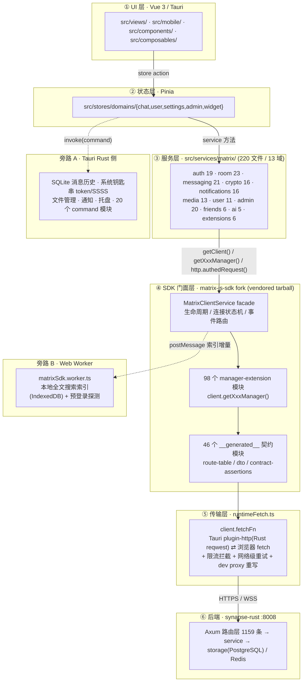
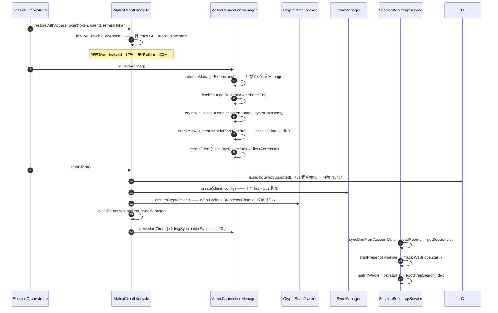

# TJG 通过集成 SDK 与后端交互的架构说明与能力图谱

- 调研日期：2026-10-08
- 调研对象：`Tjg/`（客户端）、`matrix-js-sdk/`（SDK fork）、`synapse-rust/`（后端）
- 版本锚点：`matrix-js-sdk@40.2.0-langkebo.5`（commit `640cc44`）、`synapse-rust@04dd417`
- 配套图形：`Tjg-SDK-集成架构与能力图谱-2026-10-08.html`

---

## 0. 一句话结论

TJG 不直接写 HTTP。它把 **matrix-js-sdk fork 当作唯一的协议出口**：Vue 组件只调 Pinia action，
Pinia action 只调 `src/services/matrix/` 下的 service 类，service 类通过 `matrixClientService.getClient()`
拿到 `MatrixClient` 实例后调用 SDK 方法；SDK 内部再经一层**运行时传输适配**（Tauri 原生 HTTP → 限流 → 重试）
打到 synapse-rust 的 1159 条路由上。

因此「集成 SDK 能实现什么」= **标准 Matrix 协议的全部客户端能力** + **synapse-rust 通过 vendor 命名空间与
Admin API 暴露的私有能力**，两者共用同一套鉴权、限流、重试、持久化管线。

---

## 1. 六层集成架构



### 各层职责与文件锚点

| 层 | 职责 | 关键文件 |
|---|---|---|
| ① UI | 只 emit / 调 action，禁止 import `matrix-js-sdk` | `src/components/`、`src/mobile/`、`src/views/` |
| ② Store | 乐观渲染、持久化（localStorage）、组织业务动作 | `src/stores/domains/` |
| ③ Service | 编排：txnId、重试、缓存、错误翻译、能力探测 | `src/services/matrix/**`（220 个非测试文件） |
| ④ SDK 门面 | 协议实现、加密、事件、同步、契约类型 | `vendor/matrix-js-sdk.tgz` → `matrix-js-sdk/src/` |
| ⑤ 传输 | 运行时 fetch 选择、限流、重试、取消语义 | `src/services/matrix/network/runtimeFetch.ts` |
| ⑥ 后端 | 路由 → service → 存储 | `synapse-rust/src/web/routes/` |
| 旁路 A | 本地能力（不走 Matrix 链路） | `src-tauri/src/command/`（20 个模块） |
| 旁路 B | 搜索索引 + 预登录探测 | `src/workers/matrixSdk.worker.ts` |

---

## 2. Service 层接触 SDK 的四种方式

统计口径：`src/services/matrix/` 下非测试 `.ts` 文件。

| # | 方式 | 用量 | 代表文件 | 说明 |
|---|---|---|---|---|
| ① | `extends BaseMatrixService` → `this.getClient()` → `client.xxx()` | **40 个服务** | `messaging/MatrixMessageService.ts` | 最主流。SDK 原生方法直调 |
| ② | `client.getXxxManager()` 域管理器 | ~50 个管理器被调用 | `admin/*`、`crypto/*`、`friends/*` | fork 把 MatrixClient 拆成 98 个 Manager 扩展 |
| ③ | `client.http.authedRequest()` | **10 个服务** | `MatrixHttpClient.ts` 及其使用者 | 复用 SDK 鉴权，但绕过 Manager 层 |
| ④ | `SynapseExtensionHttpBase` 内裸 `fetch` | **4 个子类** | `extensions/SynapseFriendExtensionService.ts` 等 | vendor 私有端点，独立持有 baseUrl/token |

```ts
// ① 典型形态 —— src/services/matrix/BaseMatrixService.ts:27
protected getClient(): MatrixClient {
  const client = this.provider.getClient() ?? (this.hasExplicitFallback ? this.fallbackClient : null)
  if (!client) throw new Error(this.t('matrix_error.common.client_not_initialized'))
  return client
}
```

`BaseMatrixService` 通过 `MatrixClientProvider` 间接依赖 `matrixClientService` 单例
（`globalThis.__TJG_MATRIX_CLIENT_SERVICE__` 守卫 HMR 重复实例化），并支持注入 fallback client 便于测试。

---

## 3. 端到端调用链：发送一条文本消息

> **层级修正：**主链路是 **组件 → composable（`useMsgInput*` / `useMessageSender`）→ service → SDK**，
> Pinia store 是在 composable 里被调用的**状态镜像与乐观渲染目标**，不是消息发送的中间站。
> 组件与 composable 之间通过 `useMsgInput()` 聚合注入，不是 emit 到 store action。

```mermaid
sequenceDiagram
    autonumber
    participant U as MsgInput.vue
    participant H as useMsgInput / useMsgInputSend
    participant S as useMessageSender
    participant P as Pinia chatStore
    participant M as MatrixMessageService
    participant E as MatrixEventService
    participant C as MatrixClient (SDK)
    participant F as runtimeFetch
    participant R as synapse-rust

    U->>H: @keydown.enter → send() / 发送按钮
    H->>H: getMessageContentType() → getStrategy() → buildMessageBody()
    H->>P: tempMsgId='T'+Date.now(); pushMsg(乐观渲染, SENDING)
    H->>S: sendWithTracking({ tempMsgId, payload })
    S->>S: 连接门控 navigator.onLine && state==='CONNECTED'<br/>否则 offlineQueueService.enqueue()
    S->>M: matrixMessageService.sendStructuredMessage(payload)
    M->>M: sendWithRetry（≤3 次，指数退避 1s→2s）
    M->>E: sendEvent(roomId, 'm.room.message', content)
    E->>E: 加密房间但 crypto 未就绪 → 提前抛错（避免堵住 SDK 发送队列）
    E->>C: client.sendEvent(...)
    C->>C: encryptAndSendEventWorkflow（E2EE 房间走 Rust Crypto WASM）
    C->>F: authedRequest('PUT', '/rooms/{id}/send/m.room.message/{txnId}')
    F->>F: 限流熔断 + 重试
    F->>R: HTTPS（Tauri Rust reqwest 或浏览器 fetch）
    R-->>C: 200 { event_id }
    C-->>P: RoomEvent.Timeline → RealtimeService → chatStore
    P->>P: checkMsgExist → updateMsg(status=SUCCESS, newMsgId=event_id)
    Note over P,W: 旁路：MatrixEventRouter 同时 postMessage 给 Worker<br/>更新 IndexedDB 全文搜索索引
```

**关键观察：** `MatrixMessageService.ts` 全文仅 374 行，发送路径只做了 `txnId 生成 + 重试包装 + 日志`。
加密、事务去重、时间线插入、失败重发、E2EE 判定全部由 SDK 承担——这正是「集成 SDK」相对「手写 REST」的核心收益。

**最终落点：** `PUT /_matrix/client/v3/rooms/{roomId}/send/m.room.message/{txnId}`

### 其他动作的最终端点

| 业务动作 | 端点 | 关键代码 |
|---|---|---|
| 发文本消息 | `PUT /_matrix/client/v3/rooms/{id}/send/m.room.message/{txnId}` | `MatrixMessageService.ts:135-153` |
| 撤回 | `PUT /_matrix/client/v3/rooms/{id}/redact/{eventId}/{txnId}` | `MatrixMessageService.recallMessage:212` |
| 编辑 | 同发送，内容带 `m.relates_to` / `m.replace` | `MatrixMessageRelationService` |
| 上传媒体 | `POST /_matrix/media/v3/upload` | `MediaManager.uploadContent` |
| 建立同步 | `POST /_matrix/client/unstable/org.matrix.simplified_msc3575/sync` | `SlidingSync.start` |
| 登录 | `POST /_matrix/client/v3/login` | `MatrixClientAuth` / `MatrixClientAuthHttp` |
| token 刷新 | `POST /_matrix/client/v3/refresh` | `MatrixTokenManager.refresh:72` |
| deviceId 预解析 | `GET /_matrix/client/v3/account/whoami` | `MatrixClientLifecycle.ts:358-377`（裸 fetch） |

### 事件回流有两条并行路径（其一为死路径）

| 路径 | 实现 | 状态 |
|---|---|---|
| `MatrixRoomRealtimeService.onTimelineEvent` | `room/RealtimeService.ts:126-141` 直接 `client.on(RoomEvent.Timeline)` | **实际生效**，由 `stores/domains/chat/room/sync.ts:203-227` 消费 |
| `MatrixEventRouter.emit('timeline')` | `MatrixEventRouter.ts:121-137` | **无任何消费者**（全仓 grep 仅命中自身 emit），冗余双轨 |

发送路径代码锚点：`src/services/matrix/messaging/MatrixMessageService.ts:135-153`

```ts
async sendTextMessage(roomId: string, content: string, txId?: string): Promise<ISendEventResponse> {
  const client = this.getClient()
  const txnId = txId || `m${Date.now()}`
  const response = await client.sendTextMessage(roomId, content, txnId)
  ...
}
```

---

## 4. 冷启动 / 会话恢复链路



### 连接状态机

```
DISCONNECTED → CONNECTING → CONNECTED → SYNCING → CATCHUP → SYNCED
                                 ↘ ERROR →（指数退避重连）→ RECONNECTING
```

映射实现：`MatrixConnectionManager.mapSyncState()`（`:199-234`），
SDK 的 `SyncState`（PREPARED / SYNCING / CATCHUP / RECONNECTING / ERROR / STOPPED）→ 上述状态；
连续 3 次 sync lifecycle 错误且当前 CONNECTED 时降级为 RECONNECTING（`handleSyncLifecycleError`）。

### Sliding Sync 配置要点

`MatrixSyncManager.create()`（`:89-187`）订阅了 **4 个 list**：

| list | 过滤条件 | timeline_limit |
|---|---|---|
| `default` | 无 | 按网络预设（wifi 10 / 4g 5 / 3g 3 / slow-2g 1） |
| `friends` | `room_types: ['im.hula.friend_list']`（synapse-rust 私有） | 1 |
| `spaces` | `room_types: ['m.space']` | 1 |
| `dms` | `is_dm: true` | 1 |

- 房间范围按网络自适应：wifi `[0,49]` / 4g `[0,29]` / 3g `[0,19]` / slow-2g `[0,9]`
- `pos` 持久化到 localStorage，**TTL 25min**，刻意对齐后端 `CONNECTION_TTL_MS = 30min`
- 仅当 room store 已有房间数据时才恢复增量 pos，否则清 pos 强制全量同步
- 收到 HTTP 400 → 清 pos（后端已 GC session）

---

## 5. 后端 API 表面（1159 条路由）

`matrix-js-sdk/docs/api-contract/generated/route-manifest.all.json` 统计：

| 命名空间 | 路由数 | 占比 | TJG 接入方式 |
|---|---:|---:|---|
| `/_matrix/client/v3` | 395 | 34.1% | SDK 原生方法 / 域 Manager |
| `/_synapse/admin/**` | 295 | 25.5% | `client.getAdminManager()` 等 20 个 admin 服务 |
| `/_matrix/client/v1` | 219 | 18.9% | SDK 原生方法（spaces / timestamp_to_event 等） |
| `/_matrix/vendor/v1` | 68 | 5.9% | 好友 / 语音 / 阅后即焚 / 密钥轮换（**synapse-rust 私有**） |
| `/_matrix/federation` | 44 | 3.8% | 服务端间（客户端不直接使用） |
| `/_matrix/media/**` | 32 | 2.8% | `client.getMediaManager()` |
| `/_synapse/worker` | 26 | 2.2% | 管理/遥测 |
| `/_matrix/client/unstable` | 23 | 2.0% | Sliding Sync、MSC4108 QR、MSC4143 RTC |
| `/_matrix/app` | 12 | 1.0% | Application Service |
| 其他 | 45 | 3.9% | well-known / cas / key / health |

### 路由数 Top 12 后端模块

| 模块 | 路由 | 模块 | 路由 |
|---|---:|---|---:|
| `room` | 99 | `app_service` | 39 |
| `key_backup` | 66 | `e2ee` | 38 |
| `friend_room` | 65 | `media` | 36 |
| `federation` | 55 | `voice` | 30 |
| `space` | 48 | `admin::user` | 26 |
| `admin::room` | 46 | `thread` | 23 |

### 契约生成链路（三仓库协同的护城河）

```mermaid
flowchart LR
    A["synapse-rust<br/>route_ledger.rs / ledger_export.rs"] -->|"导出 fixture"| B["tests/unit/fixtures/ledger_export_sdk/"]
    B -->|"pnpm contract:sync"| C["matrix-js-sdk<br/>docs/api-contract/generated/"]
    C -->|"pnpm contract:codegen"| D["src/&lt;module&gt;/__generated__/<br/>route-table.ts · dto.ts · contract-assertions.ts"]
    D -->|"SDK_PATHS"| E["Tjg<br/>src/services/matrix/paths/sdk-paths.ts"]
    E --> F["MATRIX_PATHS<br/>+ 契约测试强制一致"]
    F --> G["meta/sdk-pin.json<br/>锁 commit + SHA256"]
```



46 个生成模块：`account-data`、`admin`、`app-service`、`auth`、`background-update`、`burn-after-read`、
`captcha`、`cas`、`device`、`dm`、`e2ee`、`ephemeral`、`event-report`、`external-service`、`feature-flags`、
`federation`、`friend`、`guest`、`key-backup`、`key-rotation`、`media`、`moderation`、`module`、
`notifications`、`oidc`、`presence`、`push`、`reactions`、`relations`、`rendezvous`、`room-summary`、`room`、
`saml`、`search`、`sliding-sync`、`space`、`sync`、`tags`、`telemetry`、`third-party`、`thread`、`typing`、
`voice`、`widget`、`worker-admin`、`worker-body`。

---

## 6. 能力图谱：通过集成 SDK 能实现的功能

图例：**标准** = 标准 Matrix 协议；**私有** = synapse-rust vendor 扩展；**混合** = 两者兼有。

### 6.1 认证与会话（auth / 19 个服务）— 混合

| 能力 | 底层 SDK API / 端点 |
|---|---|
| 用户名密码登录 | `client.login('m.login.password', {...})` |
| SSO / SAML / CAS / OIDC | `getSamlAuthManager()`、`getCasManager()`、`getOidcManager()` |
| 扫码登录（MSC4108） | `MSC4108RendezvousSession`（`/_matrix/client/unstable/org.matrix.msc4108/rendezvous`） |
| loginToken 完成登录 | `client.login('m.login.token', { token })` |
| 访问令牌登录 / 会话恢复 | `client.loginRequest` / 直接建 client |
| 登出 + 本地清理 | `client.logout()` + `clearStores()` |
| token 刷新 | 原地 `client.setAccessToken()`（身份不变绝不重建） |
| 验证码 | `getCaptchaManager()` |
| deviceId 稳定化 | `GET /_matrix/client/v3/account/whoami` |
| 服务端能力探测 | `GET /_matrix/client/v3/capabilities`、`loginFlows()`、`getVersions()` |

### 6.2 房间与空间（room / 23 个服务）— 混合

| 能力 | 底层 SDK API / 端点 |
|---|---|
| 创建房间 | `client.createRoom(opts)` / `CreationService` |
| 加入 / 离开 / 邀请 / 踢人 / 封禁 | `client.joinRoom` `leave` `invite` `kick` `ban` |
| 房间列表 / 单个房间 | `client.getRooms()` / `client.getRoom(id)` |
| 空间层级树 | `getSpaceManager()`、`/_matrix/client/v1/spaces/{id}/hierarchy` |
| 别名 / 标签 / 话题 / 名称 / 头像 | `createAlias` `setRoomTag` `setRoomTopic` `setRoomName` `setRoomAvatar` |
| 权限与状态事件 | `client.sendStateEvent()` |
| 成员列表与成员信息 | `room.getMembers()`、`room.currentState` |
| 历史消息分页 | `client.scrollback()` / `/rooms/{id}/messages` |
| 事件上下文 | `/rooms/{id}/context/{eventId}` |
| 时间戳定位事件 | `/_matrix/client/v1/rooms/{id}/timestamp_to_event` |
| 房间摘要 | **私有** `/rooms/{id}/summary/members` · `/summary/state` |
| 防截屏 | **私有** `/rooms/{id}/anti_screenshot` |
| 我的房间列表 | **私有** `/_matrix/vendor/v1/my_rooms` |
| 公共房间目录 | `client.publicRooms()` |
| 直接消息（DM） | `getDirectMessageManager()`、`/_matrix/vendor/v1/friends/dm/{userId}` |

### 6.3 消息与线程（messaging / 21 个服务）— 标准

| 能力 | 底层 SDK API |
|---|---|
| 文本 / HTML / Emote | `sendTextMessage` `sendHtmlMessage` `sendEmote` |
| 图片 / 文件 / 音视频 / 位置 | `sendEvent('m.room.message', content)` |
| 回复 / 编辑 | `client.relations()` / `m.replace` 关系事件 |
| 撤回（redact） | `client.redactEvent(roomId, eventId, txnId)` |
| 转发 | `MatrixForwardService` → `sendEvent` |
| 线程 | `getThreadingManager()`、`MatrixThreadApi`、`MatrixThreadState` |
| 表情回应 | `getReactionsManager()`、`m.annotation` 关系 |
| 关系查询与聚合 | `getRelationsManager()`、`/relations/{eventId}`、`/aggregations/{eventId}/{relType}` |
| typing 状态 | `client.sendTyping()` |
| 已读回执 | `getReadReceiptsManager()`、`/rooms/{id}/receipt/{type}/{eventId}` |
| 定时消息 | `getDelayedEventsManager()` |
| 阅后即焚 | **私有** `/_matrix/vendor/v1/rooms/{id}/burn`、`/user/burn/stats` |

### 6.4 端到端加密（crypto / 16 个服务）— 标准

> **确认使用 Rust Crypto（matrix-sdk-crypto-wasm），不是 legacy crypto。**
> 全仓只有 `client.initRustCrypto({ useIndexedDB, storagePassword })`
> （`MatrixCryptoStateTracker.ts:411,447`），无 `initCrypto` / `useLegacyCrypto` 分支。
> `cryptoCallbacks` 仅服务于 SSSS 私钥的**内存保险箱**（`secretStorageCallbacks.ts`），私钥不落盘。
> 多窗口并发初始化用 Web Locks（`navigator.locks`）做跨 WebView 互斥 + BroadcastChannel 协调。

| 能力 | 底层 SDK API / 端点 |
|---|---|
| Rust Crypto 初始化 | `client.initRustCrypto({ useIndexedDB, storagePassword })` |
| 加密/解密事件 | `client.getCrypto()`、`CryptoSDKAdapter` |
| 设备密钥管理 | `getDeviceKeysManager()`、`/_matrix/client/v3/keys/*` |
| 交叉签名 | `getCrossSigningManager()`（98 个扩展模块之一） |
| 密钥备份与恢复 | `getKeyBackupManager()`、`/_matrix/client/v3/room_keys/*`（66 条路由） |
| SSSS 密钥保险箱 | `createSecretStorageCryptoCallbacks()`、`secretStorageKeyVault.ts`（私钥仅驻内存） |
| SAS / QR 设备验证 | `getKeyVerificationManager()` |
| 设备信任 | `client.setDeviceVerified()`、`getDeviceTrustManager()` |
| Dehydrated device | `getDehydratedDeviceManager()` |
| 密钥轮换 | **私有** `/_matrix/vendor/v1/keys/rotation/*`（18 条路由） |
| 附件加解密 | `MatrixAttachmentEncryptionService` / `MatrixAttachmentDecryptionService` |
| 加密健康监控 | `CryptoHealthMonitor`、`MatrixCryptoStateTracker` |

### 6.5 媒体与通话（media / 13 个服务）— 混合

| 能力 | 底层 SDK API / 端点 |
|---|---|
| 上传 / 下载内容 | `getMediaManager()`、`client.uploadContent()`、`mxcUrlToHttp()` |
| 缩略图与媒体配置 | `/_matrix/media/v3/thumbnail`、`/config` |
| 媒体配额 | `getMediaQuotaManager()` |
| 大文件分片上传 | `ChunkUploadService` |
| 语音消息 | **私有** `/_matrix/vendor/v1/voice/{upload,convert,optimize,transcription,room,user,config}` |
| VoIP 通话 | `matrixVoIPService`、`client.getTurnServerManager()`、`/_matrix/client/unstable/org.matrix.msc4143/rtc/transports` |
| 位置共享 | `getBeaconManager()`、`M_LOCATION` / `M_BEACON` / `M_BEACON_INFO` |
| 本地铃声/播放 | Rust `rodio` |

### 6.6 通知与推送（notifications / 16 个服务）— 混合

| 能力 | 底层 SDK API / 端点 |
|---|---|
| Push rules 增删改查 | `getPushManager()`、`getPushRulesManager()`、`/pushrules/` |
| Pushers 注册 | `/pushers`、`/pushers/set` |
| 通知列表与 ack | `/notifications`、`/notifications/{id}/ack` |
| 通知决策门 | `notificationDecisionGate.ts`、`notificationDecision.ts` |
| 勿扰（DND）跨设备同步 | 账号数据 `syncDndFromAccountData()` |
| 房间级通知设置 | `configAccountDataSync.ts`、`MatrixRoomNotificationService` |
| 系统本地通知 | Tauri `notification` 插件 |

### 6.7 用户与好友（user 11 + friends 6）— 混合

| 能力 | 底层 SDK API / 端点 |
|---|---|
| 个人资料读写 | `getProfileManager()`、`/profile/{userId}`、`/displayname`、`/avatar_url` |
| 扩展资料字段 | `uk.tcpip.msc4133/profile/{userId}/{keyName}` |
| 在线状态 | `getPresenceManager()`、`/presence/{userId}/status`（403 缺共同房间时容忍） |
| 设备列表与管理 | `getDeviceManager()`、`/devices` |
| 三方 ID (3PID) | `getThreePidsManager()` |
| 用户目录搜索 | `getUserDirectoryManager()`、`/user_directory/search` |
| 好友列表 / 申请 / 接受 / 拒绝 / 取消 / 删除 | **私有** `/_matrix/vendor/v1/friends/*`、`getFriendManager()` |
| 好友备注 / 分组 / 搜索 / 建议 | **私有** `/friends/{userId}/note`、`/friends/groups`、`/friends/search`、`/friends/suggestions` |
| 好友 DM 与状态 | **私有** `/friends/dm/{userId}`、`/friends/{userId}/status` |
| 好友检查 | **私有** `/friends/check/{userId}` |

### 6.8 管理后台（admin / 20 个服务）— 私有（Synapse Admin API）

> **接入形态：纯 Manager extension。** 统一入口 `AdminFacadeService.sdkAdmin()`（`:189-204`）→
> `client.getAdminManager()`（类型来自 `matrix-js-sdk/admin`）。历史上散落的裸
> `http.authedRequest` 已被清除（见 `UserService.ts:72,207`、`BackgroundUpdateService.ts:8` 的修复注释；
> 当前 `admin/` 目录下 `authedRequest` 仅出现在测试与注释中）。
> 权限双层校验：Tauri 侧走 Rust 命令 `CHECK_ADMIN_STATUS`，浏览器 dev 模式回退
> `getAdminManager().getUser()` 判 `.admin`。

| 能力 | 服务 | 端点前缀 |
|---|---|---|
| 用户查询/停用/激活/重置密码/登出 | `UserService` | `/_synapse/admin/v2/users` |
| 房间列表/详情/成员/删除 | `RoomService` | `/_synapse/admin/v1/rooms` |
| 媒体配额与清理 | `MediaService` | `/_synapse/admin/v1/media` |
| 联邦目的地管理 | `FederationService` | `/_synapse/admin/v1/federation/destinations` |
| 注册令牌 | `RegistrationTokensService` | `/_synapse/admin/v1/registration_tokens` |
| 举报处理 | `ReportService` | `/_synapse/admin/v1/reports` |
| 保留策略 | `RetentionService` | `/_synapse/admin/v1/retention` |
| 通知推送管理 | `NotificationService` | `/_synapse/admin/v1/notification` |
| 安全（含 whoami / 事件） | `SecurityService` | `/_synapse/admin/v1/…` |
| 配额 | `QuotaService` | — |
| 后台更新任务 | `BackgroundUpdateService` | `/_synapse/admin/v1/background_updates` |
| 外部服务健康检查 | `ExternalServiceService` | **私有** `/_matrix/vendor/v1/external_services/*` |
| Application Service | `ApplicationService` | `/_matrix/app/*` |
| 遥测 | `TelemetryService` | 含 Rust/Worker 双视图 |

### 6.9 AI 能力（ai / 5 个服务）— 私有

| 能力 | 端点（`matrixExtensionEndpoints`） |
|---|---|
| 会话管理 | `conversationCreateMy` `conversationUpdateMy` `conversationDeleteMy` `conversationPage` `conversationGetMy` |
| 消息 | `messageSendStream`（流式）`messageListByConversationId` `messageDelete` `messageSaveGeneratedContent` |
| 模型 | `modelPage` `modelUpdate` `modelDelete` `modelRemainingUsage` `getAssistantModelList` `platformList` `platformAddModel` |
| 角色 | `chatRolePage` `chatRoleCategoryList` `chatRoleCreate/Update/Delete` |
| API Key | `apiKeyPage` `apiKeyCreate` `apiKeyUpdate` `apiKeyDelete` `apiKeyBalance` `apiKeySimpleList` |
| 多模态生成 | `imageDraw` `videoGenerate` `audioGenerate` `audioVoices` + 各自的 `*MyPage` / `*MyListByIds` |
| 地图 | `mapCoordTranslate` `mapReverseGeocode` `mapStatic` |

> 开关：`VITE_AI_EXTENSION_ENABLED`。关闭时 `MatrixHttpClient.isAiExtensionEndpoint()` 直接抛
> `AIExtensionDisabledError`，不发请求（`MatrixHttpClient.ts:104-149, 241-247`）。

### 6.10 搜索 / 同步 / Widget

| 域 | 能力 |
|---|---|
| **搜索** | 服务端 `getSearchManager()`；本地全文索引在 Worker + IndexedDB（`searchIndexDb.ts`），支持房间/事件增量 upsert、撤回删除、重置 |
| **同步** | Sliding Sync 多列表、网络自适应、pos 增量与过期清理、不可用时降级传统 `/sync`、系统唤醒强制重连 |
| **Widget** | `getWidgetManager()` / `getWidgetsManager()`、能力协商 `/rooms/{id}/widgets/{wid}/capabilities`、发消息 `/send` |
| **Moderation** | `client.reportEvent()`、`MatrixEventReportService`、MSC4260 房间举报 `/rooms/{id}/report`、评分 `/report/{eventId}/score`、举报扫描器信息 |

---

### 6.11 私有扩展命名空间速查

TJG 用到的非标准命名空间（这是「SDK 之外」的全部增量）：

| 命名空间 | 用途 | 载体 | 消费方 |
|---|---|---|---|
| `/_matrix/vendor/v1/friends/*` | 好友关系、申请、分组、备注、搜索、DM | FriendManager 扩展 + REST（`SynapseExtensionHttpBase`） | synapse-rust |
| `/_matrix/vendor/v1/voice/*` | 语音消息上传/转码/优化/转写、RTC transports | `client.getVoiceManager()` | synapse-rust |
| `/_matrix/vendor/v1/rooms/{id}/burn`、`/user/burn/stats` | 阅后即焚 | `BurnAfterReadManager` 扩展 + path 常量 | synapse-rust |
| `/_matrix/vendor/v1/keys/rotation/*` | 设备密钥轮换 | `client.getKeyRotationManager()` | synapse-rust |
| `/_matrix/vendor/v1/external_services/*` | 外部服务健康检查 | `AdminManager.externalService` | synapse-rust |
| `/_matrix/vendor/v1/my_rooms` | 「我的房间」私有列表 | REST | synapse-rust |
| `/_matrix/vendor/v1/rooms/{id}/summary/*` | 房间摘要 | `SynapseRoomSummaryService` | synapse-rust |
| `/_synapse/admin/**`（295 条） | 全部管理后台能力 | `client.getAdminManager()` | synapse-rust |
| `io.hula.notification_settings` | 通知配置跨设备同步 | 账号数据 | 双端 |
| `io.hula.dnd_settings` | 勿扰时段跨设备同步 | 账号数据 | 双端 |
| `io.hula.friends` / `io.hula.voice_extended` / `io.hula.burn_after_read` | 能力标志（**刻意不出现在 `/versions`**，见后端 `capability_governance.rs:696-701`） | `/capabilities` | 双端 |
| `im.hula.invite_policy` / `im.hula.invite_blocklist` | 邀请策略账号数据 | 账号数据 | **后端消费**（`invitePolicy.ts:55`） |
| `tjg.room.notification_settings` | 房间级通知等级与盾牌 | 房间账号数据 | 客户端 |
| `com.hula.privacy` | 防截屏房间状态事件 | 房间状态 | synapse-rust |
| `m.friends` / `m.friends.list` | 好友列表房间类型与状态事件 | 房间类型 + 状态事件 | synapse-rust |
| `m.special_friends` | 特别关注好友 | 标准账号数据类型 | 客户端 |
| `m.encrypted_file`（v2 / `A256CTR`） | 加密附件（客户端 WebCrypto 自实现） | 媒体 | 标准 |

---

## 7. 横切机制：限流 / 去重 / 重试挂在哪

| 机制 | 文件 | 插桩点 | 行为 |
|---|---|---|---|
| 运行时传输选择 | `network/runtimeFetch.ts:230` | `createClient({ fetchFn })` — SDK 所有 HTTP 都走它 | Tauri 下用 Rust reqwest；失败回退浏览器 fetch；dev 环境重写为 Vite proxy |
| 限流拦截 | `MatrixRateLimitInterceptor.ts` | `getRuntimeAwareFetch()` 的返回值被 `createRateLimitedFetch` 包裹 | 按 429 / `Retry-After` / `x-ratelimit-remaining` 退避排队 |
| 网络级重试 | `network/runtimeFetch.ts:138` | `fetchWithRetry` | 仅对连接拒绝/超时等网络错误指数退避 2 次；4xx/5xx 不重试 |
| 取消语义归一 | `network/runtimeFetch.ts:99-112` | Tauri plugin-http 资源表竞态 | 「resource id invalid」/「Request cancelled」→ `AbortError`，避免 `/sync` 幽灵重放 |
| 请求去重 | `MatrixRequestDeduper.ts` | service 层显式调用 | 合并同一时刻的相同在途请求 |
| Token 刷新 | `MatrixTokenManager.ts` | `ConnectionManager.tryUpdateAccessTokenInPlace` | 身份等价时绝不重建 client |
| Store 缓存 | `storeFactory.ts` | `createClient({ store })` | per-user `IndexedDBStore`；多窗口 startup 锁；失败降级 `MemoryStore` |
| 前缀剥离 | `MatrixHttpClient.stripMatrixPrefix()` | `authedRequestWithPath` | 防止「完整前缀 + SDK 默认前缀」导致 URL 翻倍 404 |

### 关键代码锚点

```ts
// src/services/matrix/MatrixConnectionManager.ts:154-166
const clientOpts: ICreateClientOpts = {
  baseUrl: config.homeserverUrl,
  deviceId: config.deviceId,
  accessToken: config.accessToken,
  userId: config.userId,
  useAuthorizationHeader: true,
  allowInsecureHttp: config.allowInsecureHttp,
  fetchFn,                       // ← 传输层插桩
  cryptoCallbacks,               // ← SSSS 私钥仅驻内存
  store: await createMatrixStore(config.userId)   // ← 持久化插桩
}
```

---

## 8. 值得注意的耦合与风险点

### ① 设置/撤销群管理员调用了一个不存在的 SDK 方法（P0，活跃路径）

```ts
// src/services/matrix/room/RoomOperations.ts:495-498
async setMemberPowerLevel(roomId: string, userId: string, powerLevel: number): Promise<void> {
  const client = this.getClient()
  await client.setUserPowerLevel(userId, roomId, powerLevel)   // ← 参数顺序反了，且方法不存在
}
```

实测（在已安装的 vendored 包 `Tjg/node_modules/matrix-js-sdk` 内检索）：

| 检查项 | 结果 |
|---|---|
| `setUserPowerLevel` 的运行时实现 | **全包 `src/` + `lib/` 仅 1 处命中**，即 `src/matrix-client-extensions.ts:362` 的**类型声明**；无任何 `MatrixClient.prototype` 实现、无 Manager 实现 |
| SDK 声明的签名 | `setUserPowerLevel(roomId, userId, powerLevel)` —— 与 Tjg 传入的 `(userId, roomId, powerLevel)` **顺序相反** |
| SDK 真正可用的等价 API | `StateSendManager.setPowerLevel(roomId, userId, powerLevel)`（`src/state-send/index.ts:59`） |

调用链是**活跃的用户可见路径**：

```
右键菜单 contextMenuLists.ts:560 / :589
  → groupStore.addAdmin / revokeAdmin（stores/domains/chat/group/roles.ts:94 / :108）
    → matrixRoomMemberFacade.setMemberPowerLevel(roomId, uid, 100 | 0)
      → client.setUserPowerLevel(...)   ← TypeError
```

预期表现：`TypeError: client.setUserPowerLevel is not a function`，被 `roles.ts` 的
`catch` 捕获后 `logger.error('添加管理员失败')` 并重新抛出——即「设为管理员 / 撤销管理员」功能失效。
修法：改调 `client.getStateSendManager().setPowerLevel(roomId, userId, powerLevel)`，
或改用 `client.sendStateEvent('m.room.power_levels', …)` 读改写（注意并发保护）。

### ② Worker 名不副实

`MatrixWorkerHost` 对外只暴露 15 个方法：`ping`、`getServerVersions`、`getLoginFlows`、
`probeSlidingSyncEndpoints`、`probeCors`、`getCapabilities`、`resetSearchIndex`、`clearStores`、
`getStats`、以及 8 个 `search.*`。它**没有**暴露 `initialize` / `login` / `startClient` / `stopClient` /
`syncOnce` / `getClient`，主线程也从不发送这些消息（已 grep 全仓确认无调用点）。

后果：
- Worker 内 `state.client` 永远为 `null` → `handleGetStats()` 恒返回 `null`、`handleClearStores()` 恒为 no-op
  （而 `StorageSettings.vue` / `MobileStorageSettings.vue` 正在调这两个方法）
- CLAUDE.md 中「Matrix SDK 运行在 Web Worker，主线程阻塞 < 50ms」目前是**设计意图**；
  `MatrixWorkerHost.ts` 自身注释也承认这是「最小可用骨架（P4）……故意不复刻 MatrixClient 全表面」

实际运行在 Worker 里的只有：**本地搜索索引** + **预登录探测**。

### ③ 四条 SDK 接入路径并存，且同一后端路由常有多套实现

`client.xxx()`（40 服务）、`getXxxManager()`、`client.http.authedRequest()`（10 服务）、
`SynapseExtensionHttpBase` 裸 `fetch`（4 子类）。后两者绕过 Manager 层，
错误语义、限流覆盖、契约校验强度都不一致。

实测的并行实现：

| 能力 | 实现 A（SDK Manager） | 实现 B | 实现 C |
|---|---|---|---|
| 房间能力 | `MetadataService.ts:32`（`getRoomManager().getRoomCapabilities()`） | `RoomCapabilitiesService.ts:52`（`matrixHttpClient` + 自建 5min 缓存 + `MatrixRequestDeduper`） | — |
| 房间摘要 | `SummaryService.ts:110`（`synapseRoomSummaryService`） | `MatrixRoomSummaryService.ts:221-366`（SDK `RoomSummaryManager`） | `extensions/SynapseRoomSummaryService.ts`（裸 HTTP） |
| sticky events | `RoomOperations.ts:448/462`（`getRoomManager()`） | `extensions/SynapseStickyEventService.ts:24`（裸 HTTP） | — |

其中 `synapseRust.rooms.contract.test.ts:96` 明确把 `getClient()` mock 成 `null`，
专门验证「非 SDK 路径」——说明这条并行路径是被有意保留的，而非纯遗留。

### ③b 其他静态可见风险（未逐一验证运行时影响）

| 项 | 位置 | 说明 |
|---|---|---|
| 空实现存根 | `RoomOperations.ts:318-336` | `incrementUnread` / `clearUnread` 只 `getRoom()` 后吞异常，无实际逻辑 |
| 非原子读改写 | `RoomOperations.ts:427-442`（pin/unpin）、`:223-234`（setDirectRoom）、`:570-595`（pushRule 先删后建） | 无并发保护 |
| 实参顺序存疑 | `MatrixMessageService.ts:169/189` | `sendHtmlMessage` / `sendEmote` 传入的 `m<timestamp>` 型 txnId 不满足 SDK 的 `$`/null 前缀消解规则 |
| 无实现的 `MatrixClient` 方法 | `MatrixClientAuth.ts:199` `client.login()`；`MatrixOidcService.ts:178` `client.oidcUserInfo()`；`MatrixDelayedEventsService.ts:205` `client._unstable_getDelayedEvents` | 均只有类型声明；前两者有 HTTP/静默回退兜底，第三个无兜底 |
| 第三方裸 HTTP | `RoomOperations.ts:369-371` | 翻译兜底直连 `translate.googleapis.com`，完全脱离 Matrix 生态 |
| 本地重算而非用 SDK | `MatrixThreadService.ts` 全域、`MatrixReactionService.ts:135-182`、`relationQueries.ts:23-165` | **从未调用 SDK `room.getThread()` / `thread.timeline`**，只覆盖 live timeline 窗口；服务端 bundled aggregation 与窗口外线程回复不可见 |
| 线程状态编码 | `MatrixThreadState.ts:181/204/226` | `m.thread_mute` / `m.thread_freeze` / `m.thread_unfreeze` 既非 MSC 也未见后端实现，读回靠遍历全部房间 timeline（`:84-132`） |

### ④ 前缀剥离是症状性修复

`stripMatrixPrefix()` 维护一张 11 项的前缀表并循环剥离，说明路径常量与 SDK 默认前缀约定不统一。

### ⑤ 构建依赖 sibling 源码路径

`src/services/matrix/paths/sdk-paths.ts` 深度导入：

```ts
import { ROOM_ROUTES } from '../../../../../matrix-js-sdk/src/room/__generated__/route-table'
```

绕过 SDK `package.json` 的 `exports`。在纯净 tarball 消费模式（无 sibling 仓库）下该路径不存在，
`pnpm install` 后的独立检出构建会失败。

### ⑥ Sliding Sync 好友列表过滤常量与后端不匹配（实证）

`MatrixSyncManager.ts:119` 声明：

```ts
friends: { room_types: ['im.hula.friend_list'] }
```

但后端 Sliding Sync 的 `room_types` 过滤只按**房间创建时的 type** 匹配
（`synapse-storage/src/sliding_sync/models.rs:336` 起 `SlidingSyncFilters.room_types`），
而 synapse-rust 创建好友列表房间时用的类型是 **`m.friends`**：

```rust
// synapse-services/src/friend_room_service/mod.rs:156-162
let config = FriendRoomCreateRoomConfig {
    name: Some("Friends".to_string()),
    room_type: Some("m.friends".to_string()),
    ..
};
```

全仓检索 `im.hula` 在 synapse-rust 中 **0 命中**（只有 `io.hula.*` capability 命名空间与
`com.hula.privacy` 房间状态事件）。结论：`friends` 这个 Sliding Sync 列表恒为空，
好友房间实际是随 `default` 列表一起同步的。可考虑改为 `['m.friends']` 或直接删除该列表。

### ⑦ 扩展降级监控只覆盖 1/98

`src/stores/domains/chat/capability.ts:10` 只登记 `CRITICAL_EXTENSION_IDS = ['friend-manager']`。
其余 97 个 Manager 扩展（admin / voice / beacon / media / keyRotation …）缺失时不会进入 degraded 告警，
只在各自调用点兜底或抛错——用户侧看不到降级信号。

### ⑧ RoomSummaryManager 方法名 10 处不匹配（潜伏缺陷，当前无调用点）

`room/MatrixRoomSummaryService.ts:9-21` 声明了一个**本地** `interface RoomSummaryManager`。
其中 10 个方法在 SDK fork 的 `RoomSummaryManager`（97 个方法）中**一个都不存在**（已逐名 grep 确认 0 命中）：

| Tjg 声明并调用 | SDK fork 实际方法 |
|---|---|
| `createRoomSummary(roomId)` | `createOrRefreshSummary(roomId, body)`（`room-summary/index.ts:395`） |
| `updateRoomSummary(roomId, updates)` | `updateSummary(roomId, body)`（`:399`） |
| `deleteRoomSummary(roomId)` | `deleteSummary(roomId)`（`:403`） |
| `syncRoomSummary(roomId)` | `syncSummary(roomId, body)`（`:407`） |
| `batchWriteMemberSummaries(roomId, members)` | `writeSummaryMembers(roomId, members)` |
| `updateMemberSummary(roomId, u, data)` | `updateSummaryMember(roomId, u, member)` |
| `deleteMemberSummary(roomId, u)` | `deleteSummaryMember(roomId, u)` |
| `recalculateStats(roomId)` | `recalculateSummaryStats(roomId, body)` |
| `recalculateHeroes(roomId)` | `recalculateSummaryHeroes(roomId, body)` |
| `clearUnread(roomId)` | `clearSummaryUnread(roomId, body)` |

**准确的影响范围（实测）：**

- 受影响的仅是 service 上的 `*ViaApi` 一族（`createRoomSummaryViaApi` / `updateRoomSummaryViaApi` /
  `deleteRoomSummaryViaApi` / `syncRoomSummaryViaApi` / `batchWriteMemberSummaries` /
  `updateMemberSummary` / `deleteMemberSummary` / `getRoomSummaryStateViaApi` /
  `updateRoomSummaryStateViaApi` / `recalculateRoomStats` / `recalculateHeroes` / `clearUnreadSummary`）。
- 这些方法**全部没有调用点**（已 grep 全仓非测试代码确认）。它们用
  `if (!manager.xxx) throw new Error('…summary_manager_unavailable')` 做守卫，
  所以**一旦被调用必然抛错**，但当前不会在线上触发。
- **实际在用的** `getRoomSummary` / `getRoomSummaries` / `getAllRoomSummaries` / `getRoomListSnapshot` /
  `getAllRoomListSnapshots` / `getRoomStats` / `getRoomMembers` **完全不经过 SDK manager**，
  而是本地读 `client.getRoom(...)` 自己构造（`MatrixRoomSummaryService.ts:72-100`）——所以功能正常。

结论：这是**潜伏缺陷 + 误导性类型**，不是线上故障。修法二选一：SDK 侧补 `@deprecated` alias，
或 Tjg 侧改调用名并加契约测试（推荐后者）。

### ⑨ 4 个 SlidingSync 幻影类型声明（死声明，无调用点）

`src/types/matrix-js-sdk-augmentations.d.ts:44-57` 声明 `getList` / `subscribeToRoom` /
`unsubscribeFromRoom` / `getSyncToken` 为「Tjg 自定义的 SlidingSync 扩展」。实测：

| 方法 | SDK 实际情况 |
|---|---|
| `getList(name)` | 存在于 **`SlidingList`** 类（`sliding-sync.ts:175` 起，方法在 `:230`），不在 `SlidingSync` |
| `subscribeToRoom` | `sliding-sync.ts` 全文 **0 命中** |
| `unsubscribeFromRoom` | 全文 **0 命中** |
| `getSyncToken` | 全文 **0 命中** |
| `setInitialPos` | ✅ **真实存在**（`SlidingSync` 类 `:363`），且被 `MatrixSyncManager.ts:151` 正常调用 |

全仓检索确认这 4 个幻影方法**没有任何调用点**（`grep '\.getList(\|\.subscribeToRoom(\|…'` 在非测试代码 0 命中）。
因此它们是**误导性的死类型声明**，而非活跃运行时缺陷——但会让后续开发者以为这些 API 可用。

### ⑩ 去重器与缓存管理器基本是死资产

- `MatrixRequestDeduper` 只在 3 处被手动包裹：`room/RoomCapabilitiesService.ts:51`、
  `notifications/MatrixRoomNotificationService.ts:77`、`notifications/MatrixPushService.ts:23`。
  **发消息、建房间、上传都不去重**；没有任何 HTTP 层引用它。
- `MatrixCacheManager` 在生产代码里只被 `main.ts:76,78` 读 stats，无任何 get/set/getOrFetch 调用。

### ⑪ 裸请求与守卫盲区

| 位置 | 形式 | 过限流？ | 守卫可见？ |
|---|---|---|---|
| `media/mediaUploadHelpers.ts:48-111` | **XMLHttpRequest** → `POST /_matrix/media/v3/upload` | ❌ | ❌ 正则 `\bfetch\(` 抓不到 XHR |
| `workers/workerProbeHandlers.ts` | worker 内 `fetch` | ❌ | ✅ 白名单 |
| `App.vue:361`、`useAvatarUpload.ts:126`、`strategy/strategies/video.ts:144` | 业务 fetch | ❌ | ✅ 白名单 |
| `MatrixClientLifecycle.ts:358-377`（whoami）、`MatrixClientAuthHttp.ts`、`MatrixHttpClient.ts:272-306`、`SynapseExtensionHttpBase.ts` | `runtimeFetch` | ✅ | ❌ 但走统一传输层 |
| `workers/workerClientHandlers.ts` 的第二个 SDK client | SDK 默认 `globalThis.fetch` | ❌ | ✅ 白名单 |

### ⑫ 契约链是真正的护城河

1159 条路由 / 46 个生成模块 / `meta/sdk-pin.json` 锁 commit + SHA256 /
`friends.contract.test.ts` 等契约测试强制前后端一致。这套机制让「后端改路由 → 前端编译失败」成为可能，
是三仓库协同里最有价值的部分，应当在后续演进中保持。

---

## 9. 附：SDK fork 相对上游 matrix-js-sdk 增加了什么

TJG 消费的不是官方 SDK，而是一个定制 fork。相对上游 v40.x，它加了六大类东西：

### A. 架构级重构

| 改动 | 说明 |
|---|---|
| MatrixClient 分解 | `src/client.ts` + **49 个 `src/client-*.ts`**（`client-send-*` 发送管线、`client-*-requests` API、`client-*-core` 核心逻辑） |
| Manager 化 | `src/manager-extensions/`（98 个扩展）+ `src/client-infra/manager-registry.ts`（100 个 `ManagerName`）+ `src/managers/base-manager.ts`（统一 `request()` / `withRetry()` / `adminRequest()` / `normalizeError()`） |
| 异步挂载门控 | `createClient()` 同步返回时只有同步核心 manager；私有 manager 经动态 `import()` 挂载。`client.whenManagerExtensionsReady()`（`src/client.ts:929`）是唯一正确的等待点 |
| 入口收敛 | `initializeManagerExtensions()`（`src/matrix.ts:253`）。**不再使用** `matrix-js-sdk/manager-extensions` 子路径 |

### B. 契约驱动代码生成（核心差异化）

route ledger → `docs/api-contract/generated/` → `src/<module>/__generated__/`。
`path` 是 **literal type**，拼错即编译错误：

```ts
// src/friend/paths.ts:1-28
export function friendPath<const P extends string>(path: P & PathAssert<P, FriendRelativePath>): P
```

产物：**46 个 `__generated__` 目录 / 170 个文件**

| 文件类型 | 数量 | 说明 |
|---|---:|---|
| `route-table.ts` | 39 | `XXX_ROUTES` 常量 + `XXXRoute` / `XXXPath` / `XXXReplaceBraces` 类型 |
| `dto.ts` | 46 | 共 2477 行（最大 `sliding-sync` 243、`room` 206、`e2ee` 162） |
| `contract-assertions.ts` | 39 | 契约断言 |
| `acceptance.spec.ts` | 39 | 生成式验收测试 |

7 个模块只有 `dto.ts`（无 route-table）：`admin`、`app-service`、`dm`、`federation`、`feature-flags`、`key-rotation`、`reactions`。

### C. synapse-rust 私有 API 层（上游完全没有）

`src/friend/`、`src/room-summary/`、`src/voice/`、`src/widget/` + `src/widgets/`、`src/space/`、
`src/thread/` + `src/threading/`、`src/timeline/`、`src/burn-after-read/`、`src/module/`、
`src/worker-body/` + `src/worker-admin/`、`src/admin/sub-managers/*`、`src/external-service/`、
`src/telemetry/`、`src/event-report/`、`src/background-update/`、`src/retention/`、`src/security/`、
`src/feature-flags/`、`src/account-status/`、`src/invite-blocklist/`、`src/key-rotation/`、`src/dm/`、
`src/saml/`、`src/cas/`、`src/ai/`、`src/matrix-rtc/`。

### D. 版本前缀治理（ISSUE-13）

`src/http-api/prefix.ts` 新增 `VendorPrefix = '/_matrix/vendor/v1'`（`:66`）
与 `AdminPrefix.V1 = '/_synapse/admin/v1'`（`:58`）；`src/friend/**` 已全量走 `VendorPrefix`。
门禁：`scripts/quality/check-vendor-prefix-migration.mjs`。

**但迁移远未完成**：1159 条路由中 408 条（35.2%）已在 vendor/synapse 私有命名空间，
另有大量私有语义仍挂在标准前缀上——`friends` 36 条、`rooms/{r}/summary*` 17 条、`voice` 18 条、
`widgets` 18 条、`spaces` 48 条、`rooms/{r}/threads/*` 23 条、`sticky_events` 3 条、
`rooms/{r}/report*` 7 条、`rooms/{r}/dm` 2 条。

### E. 传输 / 错误 / 重试（S-8）

`src/managers/base-manager.ts`：`withRetry()` 深度计数（`:197`）防嵌套重试与双重计数；
**429 / `M_LIMIT_EXCEEDED` 允许对写请求重试，5xx / 网络超时不重试**（`:553`、`:586`），
且同一闭包内已有写成功后拒绝限流重试。

### F. 存储有界化与滑动同步定制

- `src/store/ttl.ts`（逐 key 截止 TTL，对齐后端 `CacheTtl`）
- `src/store/capacity.ts`（容量预算 + `LruMap` 淘汰）
- `src/store/pending-events-cipher.ts`（pending 队列 AES-GCM 落盘加密）
- `SlidingSync.setInitialPos()`（`sliding-sync.ts:363`）——重启后增量 sync
- `SlidingSync.isAbortLikeError()`（`:38-60`）——只把真正 abort 视为中止，
  **不再把 `fetch failed` 归为 abort**，避免断网时无退避忙循环

### G. 能力探针 fail-closed（S-13）

`src/server-capabilities/index.ts` 的 `SynapseRustFeature` 与
`doesClientAdvertiseSynapseRustFeature(client, feature, fallback, onError)`（`:149`）。
实测 fallback：

| 能力 | fallback | 位置 |
|---|---|---|
| SlidingSync | `true` | `room/RoomManager.ts:1441` |
| Friends | `true` | `friend/sub-managers/friend-list-manager.ts:111` |
| Voice | `false` | `voice/index.ts:290` |
| Widget | `false` | `widgets/index.ts:201` |
| DehydratedDevice | `false` | `dehydrated-device/index.ts:68` |
| AccountStatus | `false` | `account-status/index.ts:92` |

### H. 安全与入口工具

`assertSecureBaseUrl()`（`src/matrix.ts:267` 在 `createClient` 里强制；`allowInsecureHttp` 仅放行 dev host）、
`src/hula-client.ts` 的 `HuLaClient`、`src/common/validators.ts`、`src/common/errors.ts`、
`src/utils/lru-cache.ts`、`src/utils/execution-guard.ts`（SingleFlight，Tjg 亦使用）。

---

## 10. 附：体检数据

| 指标 | 数值 |
|---|---:|
| `src/services/matrix/` 非测试 `.ts` 文件 | 220 |
| 测试文件 | 253 |
| 继承 `BaseMatrixService` 的服务 | 40 |
| 使用 `matrixHttpClient` 的服务 | 10 |
| 继承 `SynapseExtensionHttpBase` 的服务 | 4 |
| SDK `manager-extension` 模块 | 98（默认全量注册） |
| SDK `ManagerName` 注册键 | 100 |
| SDK `__generated__` 契约目录 / 文件 | 46 / 170 |
| 后端路由总数（`route-manifest.all.json`） | 1159 |
| 其中 vendor + synapse 私有命名空间 | 408（35.2%） |
| `/_matrix/vendor/v1` 条数 | 68 |
| 后端路由模块数 | 72 |
| 后端 per-module manifest | 49 |
| Tauri command 模块 | 20 |
| 同步 list 数 | 4（default / friends / spaces / dms） |
| 前端路径契约测试 | 覆盖 friends 等模块（`paths/__tests__/`） |
| 实测缺陷 | 1 个活跃 P0（`setUserPowerLevel` 幻影方法 + 实参顺序反）、3 个潜伏/死代码、4 类守卫盲区 |
