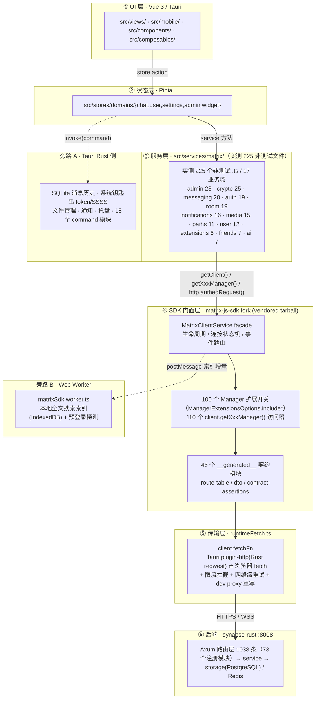
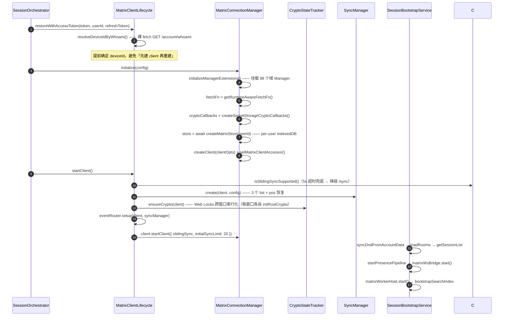

# TJG 通过集成 SDK 与后端交互的架构说明与能力图谱

- 调研日期：2026-10-08
- 调研对象：`Tjg/`（客户端）、`matrix-js-sdk/`（SDK fork）、`synapse-rust/`（后端）
- **版本锚点（2026-10-13 按实际安装物与契约台账实测）**
  - SDK：`matrix-js-sdk@40.2.0-langkebo.6`，commit `72a6c9b29`，tarball `sha256-bce405b5…`  
    （`vendor/matrix-js-sdk.tgz`，由 `meta/sdk-pin.json` 锁定，`sdk_mode: tarball`）
  - 后端：`synapse-rust@2946e19eb`，契约台账 `ledger_schema = 4`，`state_profile = all`  
    （`oidc_enabled / worker_enabled / saml_enabled` 全开）
  - 初版锚点（SDK `.5` / `640cc44`、synapse-rust `04dd417`）已被本轮实测取代
- **彻底复核日期：2026-10-13**：全文数字与 `文件:行号` 锚点**重新实测**；  
  §2/§5/§8/§9/§10 有实质变化，§8.5 为完整问题清单（含本轮新查实项）
- 配套图形：`Tjg-SDK-集成架构与能力图谱-2026-10-08.html`

---

## 0. 一句话结论

TJG 不直接写 HTTP。它把 **matrix-js-sdk fork 当作唯一的协议出口**：Vue 组件只调 Pinia action，  
Pinia action 只调 `src/services/matrix/` 下的 service 类，service 类通过 `matrixClientService.getClient()`  
拿到 `MatrixClient` 实例后调用 SDK 方法；SDK 内部再经一层**运行时传输适配**（Tauri 原生 HTTP → 限流 → 重试）  
打到 synapse-rust 的 **1038 条路由**上（`state_profile=all`，commit `2946e19eb`；  
初版的 1159 条是 2026-10-08 口径，口径与数字都已变，见 §5）。

因此「集成 SDK 能实现什么」= **标准 Matrix 协议的全部客户端能力** + **synapse-rust 通过 vendor 命名空间与  
Admin API 暴露的私有能力**，两者共用同一套鉴权、限流、重试、持久化管线。

---

## 1. 六层集成架构



### 各层职责与文件锚点

| 层         | 职责                                          | 关键文件                                                 |
| --------- | ------------------------------------------- | ---------------------------------------------------- |
| ① UI      | 只 emit / 调 action，禁止 import `matrix-js-sdk` | `src/components/`、`src/mobile/`、`src/views/`         |
| ② Store   | 乐观渲染、持久化（localStorage）、组织业务动作               | `src/stores/domains/`                                |
| ③ Service | 编排：txnId、重试、缓存、错误翻译、能力探测                    | `src/services/matrix/**`（实测 224 个非测试文件 + 243 个测试文件）  |
| ④ SDK 门面  | 协议实现、加密、事件、同步、契约类型                          | `vendor/matrix-js-sdk.tgz` → `matrix-js-sdk/src/`    |
| ⑤ 传输      | 运行时 fetch 选择、限流、重试、取消语义                     | `src/services/matrix/network/runtimeFetch.ts`        |
| ⑥ 后端      | 路由 → service → 存储                           | `synapse-rust/src/web/routes/`                       |
| 旁路 A      | 本地能力（不走 Matrix 链路）                          | `src-tauri/src/command/`（18 个 command 模块 + `mod.rs`） |
| 旁路 B      | 搜索索引 + 预登录探测                                | `src/workers/matrixSdk.worker.ts`                    |

---

## 2. Service 层接触 SDK 的四种方式

统计口径：`src/services/matrix/` 下非测试 `.ts` 文件。

| # | 方式                                                                | 用量                                 | 代表文件                                            | 说明                                                    |
| - | ----------------------------------------------------------------- | ---------------------------------- | ----------------------------------------------- | ----------------------------------------------------- |
| ① | `extends BaseMatrixService` → `this.getClient()` → `client.xxx()` | **40 个服务**                         | `messaging/MatrixMessageService.ts`             | 最主流。SDK 原生方法直调                                        |
| ② | `client.getXxxManager()` 域管理器                                     | Tjg 实测调用 **51 个**访问器（SDK 提供 110 个） | `admin/*`、`crypto/*`、`friends/*`                | fork 把 MatrixClient 拆成 100 个 Manager 扩展开关（`include*`） |
| ③ | `client.http.authedRequest()`                                     | **9 个服务**（实测）                      | `MatrixHttpClient.ts` 及其使用者                     | 复用 SDK 鉴权，但绕过 Manager 层                               |
| ④ | `SynapseExtensionHttpBase` 内裸 `fetch`                             | **4 个子类**                          | `extensions/SynapseFriendExtensionService.ts` 等 | vendor 私有端点，独立持有 baseUrl/token                        |

```ts
// ① 典型形态 —— src/services/matrix/BaseMatrixService.ts:27
protected getClient(): MatrixClient {
  const client = this.provider.getClient() ?? (this.hasExplicitFallback ? this.fallbackClient : null)
  if (!client) throw new Error(this.t('matrix_error.common.client_not_initialized'))
  return client
}
```

`BaseMatrixService` 通过 `MatrixClientProvider` 间接依赖 `matrixClientService` 单例  
（`globalThis.__TJG_MATRIX_CLIENT_SERVICE__` 守卫 HMR 重复实例化），并支持注入 fallback client 便于测试。

---

## 3. 端到端调用链：发送一条文本消息

> **层级修正：**&#x4E3B;链路是 **组件 → composable（`useMsgInput*` / `useMessageSender`）→ service → SDK**，  
> Pinia store 是在 composable 里被调用的**状态镜像与乐观渲染目标**，不是消息发送的中间站。  
> 组件与 composable 之间通过 `useMsgInput()` 聚合注入，不是 emit 到 store action。

```mermaid
sequenceDiagram
    autonumber
    participant U as MsgInput.vue
    participant H as useMsgInput / useMsgInputSend
    participant S as useMessageSender
    participant P as Pinia chatStore
    participant M as MatrixMessageService
    participant E as MatrixEventService
    participant C as MatrixClient (SDK)
    participant F as runtimeFetch
    participant R as synapse-rust

    U->>H: @keydown.enter → send() / 发送按钮
    H->>H: getMessageContentType() → getStrategy() → buildMessageBody()
    H->>P: tempMsgId='T'+Date.now(); pushMsg(乐观渲染, SENDING)
    H->>S: sendWithTracking({ tempMsgId, payload })
    S->>S: 连接门控 navigator.onLine && state==='CONNECTED'<br/>否则 offlineQueueService.enqueue()
    S->>M: matrixMessageService.sendStructuredMessage(payload)
    M->>M: sendWithRetry（≤3 次，指数退避 1s→2s）
    M->>E: sendEvent(roomId, 'm.room.message', content)
    E->>E: 加密房间但 crypto 未就绪 → 提前抛错（避免堵住 SDK 发送队列）
    E->>C: client.sendEvent(...)
    C->>C: encryptAndSendEventWorkflow（E2EE 房间走 Rust Crypto WASM）
    C->>F: authedRequest('PUT', '/rooms/{id}/send/m.room.message/{txnId}')
    F->>F: 限流熔断 + 重试
    F->>R: HTTPS（Tauri Rust reqwest 或浏览器 fetch）
    R-->>C: 200 { event_id }
    C-->>P: RoomEvent.Timeline → RealtimeService → chatStore
    P->>P: checkMsgExist → updateMsg(status=SUCCESS, newMsgId=event_id)
    Note over P,W: 旁路：MatrixEventRouter 同时 postMessage 给 Worker<br/>更新 IndexedDB 全文搜索索引
```

**关键观察：** `MatrixMessageService.ts` 全文仅 374 行，发送路径只做了 `txnId 生成 + 重试包装 + 日志`。  
加密、事务去重、时间线插入、失败重发、E2EE 判定全部由 SDK 承担——这正是「集成 SDK」相对「手写 REST」的核心收益。

**最终落点：** `PUT /_matrix/client/v3/rooms/{roomId}/send/m.room.message/{txnId}`

### 其他动作的最终端点

| 业务动作         | 端点                                                                 | 关键代码                                        |
| ------------ | ------------------------------------------------------------------ | ------------------------------------------- |
| 发文本消息        | `PUT /_matrix/client/v3/rooms/{id}/send/m.room.message/{txnId}`    | `MatrixMessageService.ts:135-153`           |
| 撤回           | `PUT /_matrix/client/v3/rooms/{id}/redact/{eventId}/{txnId}`       | `MatrixMessageService.recallMessage:212`    |
| 编辑           | 同发送，内容带 `m.relates_to` / `m.replace`                               | `MatrixMessageRelationService`              |
| 上传媒体         | `POST /_matrix/media/v3/upload`                                    | `MediaManager.uploadContent`                |
| 建立同步         | `POST /_matrix/client/unstable/org.matrix.simplified_msc3575/sync` | `SlidingSync.start`                         |
| 登录           | `POST /_matrix/client/v3/login`                                    | `MatrixClientAuth` / `MatrixClientAuthHttp` |
| token 刷新     | `POST /_matrix/client/v3/refresh`                                  | `MatrixTokenManager.ts:30`                  |
| deviceId 预解析 | `GET /_matrix/client/v3/account/whoami`                            | `MatrixClientLifecycle.ts:356-376`（裸 fetch） |

### 事件回流有两条并行路径（其一为死路径）

| 路径                                          | 实现                                                                                                             | 状态                                                                           |
| ------------------------------------------- | -------------------------------------------------------------------------------------------------------------- | ---------------------------------------------------------------------------- |
| `MatrixRoomRealtimeService.onTimelineEvent` | `room/RealtimeService.ts:126` 直接 `client.on(ROOM_EVENTS.Timeline)`（常量经 SDK 再导出，故全仓已无 `RoomEvent.Timeline` 字面量） | **实际生效**，由 `stores/domains/chat/room/sync.ts:206` 消费                         |
| `MatrixEventRouter.emit('timeline')`        | `MatrixEventRouter.ts:122`                                                                                     | **无任何消费者**（2026-10-13 复测：全仓 `"timeline"` 字面量仅 3 处，2 处在 mobile 的无关动作里），冗余双轨仍在 |

发送路径代码锚点：`src/services/matrix/messaging/MatrixMessageService.ts:135-153`

```ts
async sendTextMessage(roomId: string, content: string, txId?: string): Promise<ISendEventResponse> {
  const client = this.getClient()
  const txnId = txId || `m${Date.now()}`
  const response = await client.sendTextMessage(roomId, content, txnId)
  ...
}
```

---

## 4. 冷启动 / 会话恢复链路



### 连接状态机

```
DISCONNECTED → CONNECTING → CONNECTED → SYNCING → CATCHUP → SYNCED
                                 ↘ ERROR →（指数退避重连）→ RECONNECTING
```

映射实现：`MatrixConnectionManager.mapSyncState()`（`:204-239`），  
SDK 的 `SyncState`（PREPARED / SYNCING / CATCHUP / RECONNECTING / ERROR / STOPPED）→ 上述状态；  
连续 3 次 sync lifecycle 错误且当前 CONNECTED 时降级为 RECONNECTING（`handleSyncLifecycleError`）。

### Sliding Sync 配置要点

`MatrixSyncManager.create()`（`:89-189`）订阅了 **3 个 list**（实测仍为 3 个）：

| list      | 过滤条件                      | timeline_limit                           |
| --------- | ------------------------- | ---------------------------------------- |
| `default` | 无                         | 按网络预设（wifi 10 / 4g 5 / 3g 3 / slow-2g 1） |
| `spaces`  | `room_types: ['m.space']` | 1                                        |
| `dms`     | `is_dm: true`             | 1                                        |

> **变更（spec §5 P3-3）**：原第 4 个 `friends` list（过滤常量 `im.hula.friend_list`）已移除。该常量与后端不符（后端好友列表房间 `room_type` 为 `m.friends`），列表恒空；且前端与 SDK 均无消费点（好友数据走 SDK `FriendManager` → REST `/friends`），好友列表房间仍由无过滤的 `default` 列表覆盖。详见 §7 ⑥。


- 房间范围按网络自适应：wifi `[0,49]` / 4g `[0,29]` / 3g `[0,19]` / slow-2g `[0,9]`
- `pos` 持久化到 localStorage，**TTL 25min**，刻意对齐后端 `CONNECTION_TTL_MS = 30min`
- 仅当 room store 已有房间数据时才恢复增量 pos，否则清 pos 强制全量同步
- 收到 HTTP 400 → 清 pos（后端已 GC session）

---

## 5. 后端 API 表面（**实测 1038 条**，2026-10-13 重测）

来源：`matrix-js-sdk/docs/api-contract/generated/route-manifest.all.json`  
（`generated_at = 2026-05-02`、`synapse_rust_commit = 2946e19eb`、`state_profile = all`、  
`profile_flags = {oidc_enabled, worker_enabled, saml_enabled} = true`、`entry_count = 1038`）。

> **⚠️ 与初版的差异是口径+事实双变，不是排印错**：初版记 1159 条，本轮实测 **1038** 条。  
> 差异集中在两处 —— `/_matrix/client/v3` 395 → **257**、`/_matrix/client/v1` 219 → **110**  
> （后端收敛/合并公开路由），而 `/_matrix/vendor/v1` 68 → **197**（私有扩展面大幅增长，  
> 占比 5.9% → 19.2%）。一句话：**公开 Client API 在收敛，私有 vendor 面在扩张**，  
> 因此「哪些能力必须走 SDK fork」的比重实际在上升。

| 命名空间                       | 路由数 |    占比 | TJG 接入方式                                          |
| -------------------------- | --: | ----: | ------------------------------------------------- |
| `/_synapse/admin/**`       | 290 | 28.2% | `client.getAdminManager()` 等 admin 服务（22 个服务文件）   |
| `/_matrix/client/v3`       | 257 | 25.0% | SDK 原生方法 / 域 Manager                              |
| `/_matrix/vendor/v1`       | 197 | 19.2% | 好友 / 语音 / 阅后即焚 / 密钥轮换 / 房间摘要（**synapse-rust 私有**） |
| `/_matrix/client/v1`       | 110 | 10.7% | SDK 原生方法（spaces / timestamp_to_event 等）           |
| `/_matrix/federation`      |  44 |  4.3% | 服务端间（客户端不直接使用）                                    |
| 其他                         |  35 |  3.4% | well-known / cas / key / health                   |
| `/_matrix/media/**`        |  32 |  3.1% | `client.getMediaManager()`                        |
| `/_synapse/worker`         |  26 |  2.5% | 管理/遥测                                             |
| `/_matrix/client/unstable` |  24 |  2.3% | Sliding Sync、MSC4108 QR、MSC4143 RTC               |
| `/_matrix/app`             |  12 |  1.2% | Application Service                               |

### 路由数 Top 12 注册模块（`registered_by`，2026-10-13 重测）

|  # | 模块                         | 路由 | 与初版对比                   |
| -: | -------------------------- | -: | ----------------------- |
|  1 | `room`                     | 95 | 99 → 95                 |
|  2 | `key_backup`               | 66 | 不变                      |
|  3 | `federation`               | 55 | 不变                      |
|  4 | `admin::room`              | 45 | 46 → 45                 |
|  5 | `app_service`              | 39 | 不变                      |
|  6 | `assembly::account_compat` | 36 | 初版未单列                   |
|  7 | `e2ee`                     | 36 | 38 → 36                 |
|  8 | `media`                    | 36 | 不变                      |
|  9 | `assembly::create_router`  | 28 | 初版未单列                   |
| 10 | `friend_room`              | 28 | **65 → 28**（好友房间路由大幅收敛） |
| 11 | `space`                    | 26 | **48 → 26**             |
| 12 | `admin::user`              | 25 | 26 → 25                 |

唯一注册模块数（`registered_by` 去重）= **72**（与初版一致）。  
注：`friend_room` / `space` 的腰斩与 §5 导语里的公开路由收敛是同一批优化；  
`assembly::*` 是后端新增的组装层（account 兼容层 / create_router 汇入），初版没有这个维度。

### 契约生成链路（三仓库协同的护城河）

```mermaid
flowchart LR
    A["synapse-rust<br/>route_ledger.rs / ledger_export.rs"] -->|"导出 fixture"| B["tests/unit/fixtures/ledger_export_sdk/"]
    B -->|"pnpm contract:sync"| C["matrix-js-sdk<br/>docs/api-contract/generated/"]
    C -->|"pnpm contract:codegen"| D["src/&lt;module&gt;/__generated__/<br/>route-table.ts · dto.ts · contract-assertions.ts"]
    D -->|"SDK_PATHS"| E["Tjg<br/>src/services/matrix/paths/sdk-paths.ts"]
    E --> F["MATRIX_PATHS<br/>+ 契约测试强制一致"]
    F --> G["meta/sdk-pin.json<br/>锁 commit + SHA256"]
```



SDK 侧 `src/**/__generated__/` 实测 **46 个目录**（与初版一致），  
另有 **49 个 per-module manifest**（`docs/api-contract/generated/modules/*.json`，实测 49 个文件，  
比生成模块多出 `assembly` / `worker_body` / `relations` / `feature_flags` / `space` / `widget` 等组装层条目）。

46 个生成模块：`account-data`、`admin`、`app-service`、`auth`、`background-update`、`burn-after-read`、  
`captcha`、`cas`、`device`、`dm`、`e2ee`、`ephemeral`、`event-report`、`external-service`、`feature-flags`、  
`federation`、`friend`、`guest`、`key-backup`、`key-rotation`、`media`、`moderation`、`module`、  
`notifications`、`oidc`、`presence`、`push`、`reactions`、`relations`、`rendezvous`、`room-summary`、`room`、  
`saml`、`search`、`sliding-sync`、`space`、`sync`、`tags`、`telemetry`、`third-party`、`thread`、`typing`、  
`voice`、`widget`、`worker-admin`、`worker-body`。

---

## 6. 能力图谱：通过集成 SDK 能实现的功能

图例：**标准** = 标准 Matrix 协议；**私有** = synapse-rust vendor 扩展；**混合** = 两者兼有。

### 6.1 认证与会话（auth / 19 个服务）— 混合

| 能力                      | 底层 SDK API / 端点                                                                      |
| ----------------------- | ------------------------------------------------------------------------------------ |
| 用户名密码登录                 | `client.login('m.login.password', {...})`                                            |
| SSO / SAML / CAS / OIDC | `getSamlAuthManager()`、`getCasManager()`、`getOidcManager()`                          |
| 扫码登录（MSC4108）           | `MSC4108RendezvousSession`（`/_matrix/client/unstable/org.matrix.msc4108/rendezvous`） |
| loginToken 完成登录         | `client.login('m.login.token', { token })`                                           |
| 访问令牌登录 / 会话恢复           | `client.loginRequest` / 直接建 client                                                   |
| 登出 + 本地清理               | `client.logout()` + `clearStores()`                                                  |
| token 刷新                | 原地 `client.setAccessToken()`（身份不变绝不重建）                                               |
| 验证码                     | `getCaptchaManager()`                                                                |
| deviceId 稳定化            | `GET /_matrix/client/v3/account/whoami`                                              |
| 服务端能力探测                 | `GET /_matrix/client/v3/capabilities`、`loginFlows()`、`getVersions()`                 |

### 6.2 房间与空间（room / **19** 个服务，含新合并的 `RoomFacade`）— 混合

| 能力                     | 底层 SDK API / 端点                                                         |
| ---------------------- | ----------------------------------------------------------------------- |
| 创建房间                   | `client.createRoom(opts)` / `CreationService`                           |
| 加入 / 离开 / 邀请 / 踢人 / 封禁 | `client.joinRoom` `leave` `invite` `kick` `ban`                         |
| 房间列表 / 单个房间            | `client.getRooms()` / `client.getRoom(id)`                              |
| 空间层级树                  | `getSpaceManager()`、`/_matrix/client/v1/spaces/{id}/hierarchy`          |
| 别名 / 标签 / 话题 / 名称 / 头像 | `createAlias` `setRoomTag` `setRoomTopic` `setRoomName` `setRoomAvatar` |
| 权限与状态事件                | `client.sendStateEvent()`                                               |
| 成员列表与成员信息              | `room.getMembers()`、`room.currentState`                                 |
| 历史消息分页                 | `client.scrollback()` / `/rooms/{id}/messages`                          |
| 事件上下文                  | `/rooms/{id}/context/{eventId}`                                         |
| 时间戳定位事件                | `/_matrix/client/v1/rooms/{id}/timestamp_to_event`                      |
| 房间摘要                   | **私有** `/rooms/{id}/summary/members` · `/summary/state`                 |
| 防截屏                    | **私有** `/rooms/{id}/anti_screenshot`                                    |
| 我的房间列表                 | **私有** `/_matrix/vendor/v1/my_rooms`                                    |
| 公共房间目录                 | `client.publicRooms()`                                                  |
| 直接消息（DM）               | `getDirectMessageManager()`、`/_matrix/vendor/v1/friends/dm/{userId}`    |

### 6.3 消息与线程（messaging / 21 个服务）— 标准

| 能力                 | 底层 SDK API                                                                         |
| ------------------ | ---------------------------------------------------------------------------------- |
| 文本 / HTML / Emote  | `sendTextMessage` `sendHtmlMessage` `sendEmote`                                    |
| 图片 / 文件 / 音视频 / 位置 | `sendEvent('m.room.message', content)`                                             |
| 回复 / 编辑            | `client.relations()` / `m.replace` 关系事件                                            |
| 撤回（redact）         | `client.redactEvent(roomId, eventId, txnId)`                                       |
| 转发                 | `MatrixForwardService` → `sendEvent`                                               |
| 线程                 | `getThreadingManager()`、`MatrixThreadApi`、`MatrixThreadState`                      |
| 表情回应               | `getReactionsManager()`、`m.annotation` 关系                                          |
| 关系查询与聚合            | `getRelationsManager()`、`/relations/{eventId}`、`/aggregations/{eventId}/{relType}` |
| typing 状态          | `client.sendTyping()`                                                              |
| 已读回执               | `getReadReceiptsManager()`、`/rooms/{id}/receipt/{type}/{eventId}`                  |
| 定时消息               | `getDelayedEventsManager()`                                                        |
| 阅后即焚               | **私有** `/_matrix/vendor/v1/rooms/{id}/burn`、`/user/burn/stats`                     |

### 6.4 端到端加密（crypto / **25** 个服务）— 标准

> **确认使用 Rust Crypto（matrix-sdk-crypto-wasm），不是 legacy crypto。**  
> 全仓只有 `client.initRustCrypto({ useIndexedDB, storagePassword })`  
> （`MatrixCryptoStateTracker.ts:411,447`），无 `initCrypto` / `useLegacyCrypto` 分支。  
> `cryptoCallbacks` 仅服务于 SSSS 私钥的**内存保险箱**（`secretStorageCallbacks.ts`），私钥不落盘。  
> 多窗口并发初始化由 Web Locks（`navigator.locks`，锁名 `tjg-ensure-crypto`）**串行化**；  
> 每个 WebView 都必须有自己的 OlmMachine（同源 IndexedDB 共享同一组 crypto DB），  
> **不存在**"其他窗口已完成即跳过"的语义（2026-10-13 取证订正，原 BroadcastChannel 协调已删除）。  
> 守门：`pnpm check:crypto-cross-window`。

**crypto 生命周期（2026-10-13 按实测依赖 + 实测代码订正，勿凭上游印象改）**

- `client.stopClient()` 在 fork 里**会一并停掉 crypto**：  
  `stopClientLifecycleServices()` → `client.cryptoBackend.stop()` → `RustCrypto.stop()`  
  （置 `stopped = true`、停各 manager、`olmMachine.close()` ⇒ **IndexedDB 连接随之关闭**）。  
  这正是 login→home 交接时先 `stopClient()` 再开 home（`DesktopSessionTransition.ts:52-61`）  
  能够安全让出共享 store 的原因。
- ✅ **A3 已在 fork 侧修复（2026-10-13，fork commit `72a6c9b29`）**：`stopClient()` 在停掉 crypto 之后
  **同时清空 `client.cryptoBackend`**（`releaseCryptoBackend()`；`stopClient()` 的早退路径也走它）。
  ⇒ `initRustCrypto()` 的"见非空即 return"不再挡路，**同一个 client 可以直接重新初始化 crypto**。
- 因此 `initRustCrypto()` 见到 `cryptoBackend` 非空就 `warn("Attempt to re-initialise e2e encryption")`
  并 return 这条**仍是核心不变量**（也是 A3 必须"清绑定"而非"只停"的原因）；`getCrypto()` 只返回该字段。
  `client-lifecycle-start`（start 侧）不会替调用方恢复 crypto —— 重启路径仍须自己 `ensureCrypto`。
- ⇒ **同一个 client 实例的 crypto 不再是「一次性」的**；`forceReconnect()` 仍按  
  `stopClient() → releaseStoppedCryptoBinding() → ensureCrypto() → startClient()` 顺序处理  
  （`MatrixClientLifecycle.ts`），其中解绑调用自 A3 起**降级为兜底**（SDK 若回退成"只停不清"仍能救回
  E2EE），正常时序下它看到 `getCrypto() === undefined`（`no-crypto`）直接返回，**不是异常**。
- 真正的"已可用即不重复初始化"判据只有一处：`ensureCrypto` 开头的 `getCrypto()` 早退  
  （只对**本窗口本 client** 有效）。守门：`pnpm check:sdk-crypto-teardown`（8 条 SDK 契约，
  已随 A3 改写为"停 **并** 清空"语义）。
- 非 home 窗口**按需惰性恢复**：`sessionOrchestrator.ensureClientReady()`  
  （`SessionBootstrapService`，注释明写 "Useful for standalone WebViews"）会拉起完整  
  client + crypto；当前只有设置窗口的「安全 / 会话」两个标签页调用它（见 §8.5 问题 6）。

| 能力                   | 底层 SDK API / 端点                                                           |
| -------------------- | ------------------------------------------------------------------------- |
| Rust Crypto 初始化      | `client.initRustCrypto({ useIndexedDB, storageKey \| storagePassword })`  |
| crypto 停止/释放         | `client.stopClient()`（含 `cryptoBackend.stop()` → `olmMachine.close()`，**并清空绑定**，A3）    |
| crypto 重启（复用 client） | `client.initRustCrypto()` 可直接再初始化（A3 后无需先解绑）；Tjg 侧仍保留 `releaseStoppedCryptoBinding()` 作兜底 + `ensureCrypto()` |
| 加密/解密事件              | `client.getCrypto()`、`CryptoSDKAdapter`                                   |
| 设备密钥管理               | `getDeviceKeysManager()`、`/_matrix/client/v3/keys/*`                      |
| 交叉签名                 | `getCrossSigningManager()`（98 个扩展模块之一）                                    |
| 密钥备份与恢复              | `getKeyBackupManager()`、`/_matrix/client/v3/room_keys/*`（66 条路由）          |
| SSSS 密钥保险箱           | `createSecretStorageCryptoCallbacks()`、`secretStorageKeyVault.ts`（私钥仅驻内存） |
| SAS / QR 设备验证        | `getKeyVerificationManager()`                                             |
| 设备信任                 | `client.setDeviceVerified()`、`getDeviceTrustManager()`                    |
| Dehydrated device    | `getDehydratedDeviceManager()`                                            |
| 密钥轮换                 | **私有** `/_matrix/vendor/v1/keys/rotation/*`（18 条路由）                       |
| 附件加解密                | `MatrixAttachmentEncryptionService` / `MatrixAttachmentDecryptionService` |
| 加密健康监控               | `CryptoHealthMonitor`、`MatrixCryptoStateTracker`                          |

### 6.5 媒体与通话（media / **14** 个服务）— 混合

| 能力        | 底层 SDK API / 端点                                                                                                  |
| --------- | ---------------------------------------------------------------------------------------------------------------- |
| 上传 / 下载内容 | `getMediaManager()`、`client.uploadContent()`、`mxcUrlToHttp()`                                                    |
| 缩略图与媒体配置  | `/_matrix/media/v3/thumbnail`、`/config`                                                                          |
| 媒体配额      | `getMediaQuotaManager()`                                                                                         |
| 大文件分片上传   | `ChunkUploadService`                                                                                             |
| 语音消息      | **私有** `/_matrix/vendor/v1/voice/{upload,convert,optimize,transcription,room,user,config}`                       |
| VoIP 通话   | `matrixVoIPService`、`client.getTurnServerManager()`、`/_matrix/client/unstable/org.matrix.msc4143/rtc/transports` |
| 位置共享      | `getBeaconManager()`、`M_LOCATION` / `M_BEACON` / `M_BEACON_INFO`                                                 |
| 本地铃声/播放   | Rust `rodio`                                                                                                     |

### 6.6 通知与推送（notifications / 16 个服务）— 混合

| 能力              | 底层 SDK API / 端点                                            |
| --------------- | ---------------------------------------------------------- |
| Push rules 增删改查 | `getPushManager()`、`getPushRulesManager()`、`/pushrules/`   |
| Pushers 注册      | `/pushers`、`/pushers/set`                                  |
| 通知列表与 ack       | `/notifications`、`/notifications/{id}/ack`                 |
| 通知决策门           | `notificationDecisionGate.ts`、`notificationDecision.ts`    |
| 勿扰（DND）跨设备同步    | 账号数据 `syncDndFromAccountData()`                            |
| 房间级通知设置         | `configAccountDataSync.ts`、`MatrixRoomNotificationService` |
| 系统本地通知          | Tauri `notification` 插件                                    |

### 6.7 用户与好友（user 11 + friends 6）— 混合

| 能力                            | 底层 SDK API / 端点                                                                            |
| ----------------------------- | ------------------------------------------------------------------------------------------ |
| 个人资料读写                        | `getProfileManager()`、`/profile/{userId}`、`/displayname`、`/avatar_url`                     |
| 扩展资料字段                        | `uk.tcpip.msc4133/profile/{userId}/{keyName}`                                              |
| 在线状态                          | `getPresenceManager()`、`/presence/{userId}/status`（403 缺共同房间时容忍）                           |
| 设备列表与管理                       | `getDeviceManager()`、`/devices`                                                            |
| 三方 ID (3PID)                  | `getThreePidsManager()`                                                                    |
| 用户目录搜索                        | `getUserDirectoryManager()`、`/user_directory/search`                                       |
| 好友列表 / 申请 / 接受 / 拒绝 / 取消 / 删除 | **私有** `/_matrix/vendor/v1/friends/*`、`getFriendManager()`                                 |
| 好友备注 / 分组 / 搜索 / 建议           | **私有** `/friends/{userId}/note`、`/friends/groups`、`/friends/search`、`/friends/suggestions` |
| 好友 DM 与状态                     | **私有** `/friends/dm/{userId}`、`/friends/{userId}/status`                                   |
| 好友检查                          | **私有** `/friends/check/{userId}`                                                           |


### 6.8 管理后台（admin / **23** 个服务）— 私有（Synapse Admin API）

> **接入形态：纯 Manager extension。** 统一入口 `AdminFacadeService.sdkAdmin()`（`:189-204`）→  
> `client.getAdminManager()`（类型来自 `matrix-js-sdk/admin`）。历史上散落的裸  
> `http.authedRequest` 已被清除（见 `UserService.ts:72,207`、`BackgroundUpdateService.ts:8` 的修复注释；  
> 当前 `admin/` 目录下 `authedRequest` 仅出现在测试与注释中）。  
> 权限双层校验：Tauri 侧走 Rust 命令 `CHECK_ADMIN_STATUS`，浏览器 dev 模式回退  
> `getAdminManager().getUser()` 判 `.admin`。

| 能力                  | 服务                          | 端点前缀                                            |
| ------------------- | --------------------------- | ----------------------------------------------- |
| 用户查询/停用/激活/重置密码/登出  | `UserService`               | `/_synapse/admin/v2/users`                      |
| 房间列表/详情/成员/删除       | `RoomService`               | `/_synapse/admin/v1/rooms`                      |
| 媒体配额与清理             | `MediaService`              | `/_synapse/admin/v1/media`                      |
| 联邦目的地管理             | `FederationService`         | `/_synapse/admin/v1/federation/destinations`    |
| 注册令牌                | `RegistrationTokensService` | `/_synapse/admin/v1/registration_tokens`        |
| 举报处理                | `ReportService`             | `/_synapse/admin/v1/reports`                    |
| 保留策略                | `RetentionService`          | `/_synapse/admin/v1/retention`                  |
| 通知推送管理              | `NotificationService`       | `/_synapse/admin/v1/notification`               |
| 安全（含 whoami / 事件）   | `SecurityService`           | `/_synapse/admin/v1/…`                          |
| 配额                  | `QuotaService`              | —                                               |
| 后台更新任务              | `BackgroundUpdateService`   | `/_synapse/admin/v1/background_updates`         |
| 外部服务健康检查            | `ExternalServiceService`    | **私有** `/_matrix/vendor/v1/external_services/*` |
| Application Service | `ApplicationService`        | `/_matrix/app/*`                                |
| 遥测                  | `TelemetryService`          | 含 Rust/Worker 双视图                               |

### 6.9 AI 能力（ai / 5 个服务）— 私有

| 能力      | 端点（`matrixExtensionEndpoints`）                                                                                          |
| ------- | ----------------------------------------------------------------------------------------------------------------------- |
| 会话管理    | `conversationCreateMy` `conversationUpdateMy` `conversationDeleteMy` `conversationPage` `conversationGetMy`             |
| 消息      | `messageSendStream`（流式）`messageListByConversationId` `messageDelete` `messageSaveGeneratedContent`                      |
| 模型      | `modelPage` `modelUpdate` `modelDelete` `modelRemainingUsage` `getAssistantModelList` `platformList` `platformAddModel` |
| 角色      | `chatRolePage` `chatRoleCategoryList` `chatRoleCreate/Update/Delete`                                                    |
| API Key | `apiKeyPage` `apiKeyCreate` `apiKeyUpdate` `apiKeyDelete` `apiKeyBalance` `apiKeySimpleList`                            |
| 多模态生成   | `imageDraw` `videoGenerate` `audioGenerate` `audioVoices` + 各自的 `*MyPage` / `*MyListByIds`                              |
| 地图      | `mapCoordTranslate` `mapReverseGeocode` `mapStatic`                                                                     |

> 开关：`VITE_AI_EXTENSION_ENABLED`。关闭时 `MatrixHttpClient.isAiExtensionEndpoint()` 直接抛  
> `AIExtensionDisabledError`，不发请求（`MatrixHttpClient.ts:104-149, 241-247`）。

### 6.10 搜索 / 同步 / Widget

| 域              | 能力                                                                                                                       |
| -------------- | ------------------------------------------------------------------------------------------------------------------------ |
| **搜索**         | 服务端 `getSearchManager()`；本地全文索引在 Worker + IndexedDB（`searchIndexDb.ts`），支持房间/事件增量 upsert、撤回删除、重置                         |
| **同步**         | Sliding Sync 多列表、网络自适应、pos 增量与过期清理、不可用时降级传统 `/sync`、系统唤醒强制重连                                                             |
| **Widget**     | `getWidgetManager()` / `getWidgetsManager()`、能力协商 `/rooms/{id}/widgets/{wid}/capabilities`、发消息 `/send`                   |
| **Moderation** | `client.reportEvent()`、`MatrixEventReportService`、MSC4260 房间举报 `/rooms/{id}/report`、评分 `/report/{eventId}/score`、举报扫描器信息 |

---

### 6.11 私有扩展命名空间速查

TJG 用到的非标准命名空间（这是「SDK 之外」的全部增量）：

| 命名空间                                                                     | 用途                                                                  | 载体                                                  | 消费方                            |
| ------------------------------------------------------------------------ | ------------------------------------------------------------------- | --------------------------------------------------- | ------------------------------ |
| `/_matrix/vendor/v1/friends/*`                                           | 好友关系、申请、分组、备注、搜索、DM                                                 | FriendManager 扩展 + REST（`SynapseExtensionHttpBase`） | synapse-rust                   |
| `/_matrix/vendor/v1/voice/*`                                             | 语音消息上传/转码/优化/转写、RTC transports                                      | `client.getVoiceManager()`                          | synapse-rust                   |
| `/_matrix/vendor/v1/rooms/{id}/burn`、`/user/burn/stats`                  | 阅后即焚                                                                | `BurnAfterReadManager` 扩展 + path 常量                 | synapse-rust                   |
| `/_matrix/vendor/v1/keys/rotation/*`                                     | 设备密钥轮换                                                              | `client.getKeyRotationManager()`                    | synapse-rust                   |
| `/_matrix/vendor/v1/external_services/*`                                 | 外部服务健康检查                                                            | `AdminManager.externalService`                      | synapse-rust                   |
| `/_matrix/vendor/v1/my_rooms`                                            | 「我的房间」私有列表                                                          | REST                                                | synapse-rust                   |
| `/_matrix/vendor/v1/rooms/{id}/summary/*`                                | 房间摘要                                                                | `SynapseRoomSummaryService`                         | synapse-rust                   |
| `/_synapse/admin/**`（295 条）                                              | 全部管理后台能力                                                            | `client.getAdminManager()`                          | synapse-rust                   |
| `io.hula.notification_settings`                                          | 通知配置跨设备同步                                                           | 账号数据                                                | 双端                             |
| `io.hula.dnd_settings`                                                   | 勿扰时段跨设备同步                                                           | 账号数据                                                | 双端                             |
| `io.hula.friends` / `io.hula.voice_extended` / `io.hula.burn_after_read` | 能力标志（**刻意不出现在 `/versions`**，见后端 `capability_governance.rs:696-701`） | `/capabilities`                                     | 双端                             |
| `im.hula.invite_policy` / `im.hula.invite_blocklist`                     | 邀请策略账号数据                                                            | 账号数据                                                | **后端消费**（`invitePolicy.ts:55`） |
| `tjg.room.notification_settings`                                         | 房间级通知等级与盾牌                                                          | 房间账号数据                                              | 客户端                            |
| `com.hula.privacy`                                                       | 防截屏房间状态事件                                                           | 房间状态                                                | synapse-rust                   |
| `m.friends` / `m.friends.list`                                           | 好友列表房间类型与状态事件                                                       | 房间类型 + 状态事件                                         | synapse-rust                   |
| `m.special_friends`                                                      | 特别关注好友                                                              | 标准账号数据类型                                            | 客户端                            |
| `m.encrypted_file`（v2 / `A256CTR`）                                       | 加密附件（客户端 WebCrypto 自实现）                                             | 媒体                                                  | 标准                             |

---

## 7. 横切机制：限流 / 去重 / 重试挂在哪

| 机制       | 文件                                     | 插桩点                                                        | 行为                                                                      |
| -------- | -------------------------------------- | ---------------------------------------------------------- | ----------------------------------------------------------------------- |
| 运行时传输选择  | `network/runtimeFetch.ts:230`          | `createClient({ fetchFn })` — SDK 所有 HTTP 都走它              | Tauri 下用 Rust reqwest；失败回退浏览器 fetch；dev 环境重写为 Vite proxy                |
| 限流拦截     | `MatrixRateLimitInterceptor.ts`        | `getRuntimeAwareFetch()` 的返回值被 `createRateLimitedFetch` 包裹 | 按 429 / `Retry-After` / `x-ratelimit-remaining` 退避排队                    |
| 网络级重试    | `network/runtimeFetch.ts:138`          | `fetchWithRetry`                                           | 仅对连接拒绝/超时等网络错误指数退避 2 次；4xx/5xx 不重试                                      |
| 取消语义归一   | `network/runtimeFetch.ts:99-112`       | Tauri plugin-http 资源表竞态                                    | 「resource id invalid」/「Request cancelled」→ `AbortError`，避免 `/sync` 幽灵重放 |
| 请求去重     | `MatrixRequestDeduper.ts`              | service 层显式调用                                              | 合并同一时刻的相同在途请求                                                           |
| Token 刷新 | `MatrixTokenManager.ts`                | `ConnectionManager.tryUpdateAccessTokenInPlace`            | 身份等价时绝不重建 client                                                        |
| Store 缓存 | `storeFactory.ts`                      | `createClient({ store })`                                  | per-user `IndexedDBStore`；多窗口 startup 锁；失败降级 `MemoryStore`              |
| 前缀剥离     | `MatrixHttpClient.stripMatrixPrefix()` | `authedRequestWithPath`                                    | 防止「完整前缀 + SDK 默认前缀」导致 URL 翻倍 404                                        |

> **2026-10-13 复核**：① 「前缀剥离」一行已过时 —— `stripMatrixPrefix()` 全仓 0 命中，  
> 现由 SDK `BaseManager.authedRequestWithPrefix` + SDK `KNOWN_PREFIXES`（21 条，长前缀优先）承担（见 §8 ④）；  
> ② 「请求去重」「Store 缓存」两行描述的是**机制意图**，实际覆盖很小 —— deduper 仍只有 3 处手动包裹、  
> `MatrixCacheManager`（零调用的死资产）已整体删除、`MatrixRequestDeduper` 的误导语义已订正（见 §8 ⑩ / §8.5 C4）；③ 传输选择 / 限流 / 重试 / 取消四行锚点复核无误。

### 关键代码锚点

```ts
// src/services/matrix/MatrixConnectionManager.ts:154-166
const clientOpts: ICreateClientOpts = {
  baseUrl: config.homeserverUrl,
  deviceId: config.deviceId,
  accessToken: config.accessToken,
  userId: config.userId,
  useAuthorizationHeader: true,
  allowInsecureHttp: config.allowInsecureHttp,
  fetchFn,                       // ← 传输层插桩
  cryptoCallbacks,               // ← SSSS 私钥仅驻内存
  store: await createMatrixStore(config.userId)   // ← 持久化插桩
}
```

---

## 8. 值得注意的耦合与风险点

> **§8 复核结论（2026-10-13 逐条实测）**：① 已修复 ｜ ② **仍存在**（形态由"worker 无能力"变成"有能力但不可达"）  
> ｜ ③ **仍存在** ｜ ③b **部分修复**（2 项改走真实 API，4 项残留） ｜ ④ **已变化**（本地剥离表已删，  
> 改委托 SDK `KNOWN_PREFIXES`） ｜ ⑤ 已修复 ｜ ⑥ 已修复（属实） ｜ ⑦ 已修复（属实） ｜ ⑧ **已修复**  
> （文件 366 → 192 行，幻影接口清空） ｜ ⑨ **已修复** ｜ ⑩ **已修复**（Batch 3.3：删死缓存 + 订正去重器语义） ｜ ⑪ **部分修复**（Batch 3.1 已清 XHR 旁路；Worker/业务 fetch 仍在白名单里）。  
> 每条结论的 `文件:行号` 证据见该条目下的"2026-10-13 复核"要点。

### ① 设置/撤销群管理员调用了一个不存在的 SDK 方法（P0 —— **已修复**，2026-10-13 复核）

> **复核**：`RoomOperations.ts:499` 现调 `client.setPowerLevel(roomId, userId, powerLevel)`（与 SDK 真实签名一致，  
> SDK 侧 `node_modules/matrix-js-sdk/lib/client.js` 经 `getStateSendManager()` 转发）；全仓 `setUserPowerLevel` 已 0 命中；  
> 回归测试 `src/services/matrix/room/__tests__/RoomOperations.test.ts`（断言 `(roomId,userId,powerLevel)` 顺序与 100/0 映射）。

```ts
// src/services/matrix/room/RoomOperations.ts:495-498
async setMemberPowerLevel(roomId: string, userId: string, powerLevel: number): Promise<void> {
  const client = this.getClient()
  await client.setUserPowerLevel(userId, roomId, powerLevel)   // ← 参数顺序反了，且方法不存在
}
```

实测（在已安装的 vendored 包 `Tjg/node_modules/matrix-js-sdk` 内检索）：

| 检查项                        | 结果                                                                                                                            |
| -------------------------- | ----------------------------------------------------------------------------------------------------------------------------- |
| `setUserPowerLevel` 的运行时实现 | **全包 `src/` + `lib/` 仅 1 处命中**，即 `src/matrix-client-extensions.ts:362` 的**类型声明**；无任何 `MatrixClient.prototype` 实现、无 Manager 实现 |
| SDK 声明的签名                  | `setUserPowerLevel(roomId, userId, powerLevel)` —— 与 Tjg 传入的 `(userId, roomId, powerLevel)` **顺序相反**                          |
| SDK 真正可用的等价 API            | `StateSendManager.setPowerLevel(roomId, userId, powerLevel)`（`src/state-send/index.ts:59`）                                    |

调用链是**活跃的用户可见路径**：

```
右键菜单 contextMenuLists.ts:560 / :589
  → groupStore.addAdmin / revokeAdmin（stores/domains/chat/group/roles.ts:94 / :108）
    → matrixRoomMemberFacade.setMemberPowerLevel(roomId, uid, 100 | 0)
      → client.setUserPowerLevel(...)   ← TypeError
```

预期表现：`TypeError: client.setUserPowerLevel is not a function`，被 `roles.ts` 的  
`catch` 捕获后 `logger.error('添加管理员失败')` 并重新抛出——即「设为管理员 / 撤销管理员」功能失效。  
修法：改调 `client.getStateSendManager().setPowerLevel(roomId, userId, powerLevel)`，  
或改用 `client.sendStateEvent('m.room.power_levels', …)` 读改写（注意并发保护）。

### ② Worker 名不副实（**仍存在**，形态已变）

> **复核**：主线程侧 `MatrixWorkerHost.ts:97-213` 仍只暴露 15 个方法（ping/probe*/getStats/clearStores/8×search），  
> **从不发送** `initialize`/`login`/`startClient`/`stopClient`/`getClient`；Worker 侧其实已实现这些 handler，  
> 但 `state.client` 只在 Worker 的 `handleInitialize/handleLogin` 里赋值、主线程无调用点 ⇒ 恒为 `null`：  
> `handleGetStats()` 恒返回 `null`、`handleClearStores()` 仍 no-op，而 `StorageSettings.vue:105,119`、  
> `MobileStorageSettings.vue:89,118` 正在调它们。**结论从"worker 没能力"变成"有能力但不可达"。**

`MatrixWorkerHost` 对外只暴露 15 个方法：`ping`、`getServerVersions`、`getLoginFlows`、  
`probeSlidingSyncEndpoints`、`probeCors`、`getCapabilities`、`resetSearchIndex`、`clearStores`、  
`getStats`、以及 8 个 `search.*`。它**没有**暴露 `initialize` / `login` / `startClient` / `stopClient` /  
`syncOnce` / `getClient`，主线程也从不发送这些消息（已 grep 全仓确认无调用点）。

后果：

- Worker 内 `state.client` 永远为 `null` → `handleGetStats()` 恒返回 `null`、`handleClearStores()` 恒为 no-op  
  （而 `StorageSettings.vue` / `MobileStorageSettings.vue` 正在调这两个方法）
- CLAUDE.md 中「Matrix SDK 运行在 Web Worker，主线程阻塞 < 50ms」目前是**设计意图**；  
  `MatrixWorkerHost.ts` 自身注释也承认这是「最小可用骨架（P4）……故意不复刻 MatrixClient 全表面」

实际运行在 Worker 里的只有：**本地搜索索引** + **预登录探测**。

### ③ 四条 SDK 接入路径并存，同一后端路由曾有多套实现（**2026-10-13 已收敛**，Batch 4.3 / C2）

> **复核（2026-10-13，Batch 4.3 / C2）**：三组并行实现已逐组收敛到 **SDK 路径**，删除 4 个实现文件 +
> 4 个测试文件 —— `room/MatrixRoomSummaryService.ts`、`room/RoomCapabilitiesService.ts`、
> `extensions/SynapseStickyEventService.ts`、`composables/room/useStickyEvents.ts`
> （`StickyEventInfo` 视图模型迁 `src/types/stickyEvent.ts`）；`synapseRust.rooms.contract.test.ts`
> 去掉 sticky 覆盖，台账收紧（`doc-coverage` 963→953、`sdk-boundary` 183→181）。
> ⚠️ 下表是**收敛前**的实测快照，不要再据此判断现状。
> `synapseRust.friends.contract.test.ts:116` 仍把 `client` mock 成 `null`（friends 侧非 SDK 路径测试未收敛）。

`client.xxx()`（40 服务）、`getXxxManager()`、`client.http.authedRequest()`（10 服务）、  
`SynapseExtensionHttpBase` 裸 `fetch`（4 子类）。后两者绕过 Manager 层，  
错误语义、限流覆盖、契约校验强度都不一致。

**收敛前的并行实现（历史快照）**：

| 能力            | 实现 A（SDK Manager）                                                 | 实现 B                                                                                      | 实现 C                                              |
| ------------- | ----------------------------------------------------------------- | ----------------------------------------------------------------------------------------- | ------------------------------------------------- |
| 房间能力          | `MetadataService.ts:32`（`getRoomManager().getRoomCapabilities()`） | `RoomCapabilitiesService.ts:52`（`matrixHttpClient` + 自建 5min 缓存 + `MatrixRequestDeduper`） | —                                                 |
| 房间摘要          | `SummaryService.ts:110`（`synapseRoomSummaryService`）              | `MatrixRoomSummaryService.ts:221-366`（SDK `RoomSummaryManager`）                           | `extensions/SynapseRoomSummaryService.ts`（裸 HTTP） |
| sticky events | `RoomOperations.ts:448/462`（`getRoomManager()`）                   | `extensions/SynapseStickyEventService.ts:24`（裸 HTTP）                                      | —                                                 |


（当时）`synapseRust.rooms.contract.test.ts` 把 `getClient()` mock 成 `null` 专门验证「非 SDK 路径」。
**该文件已于 Batch 4.3 删除**；同族的 `SummaryService.ts` 与 SDK `RoomSummaryManager` 现在是唯一路径。

### ③b 其他静态可见风险（**部分修复**）

> **复核（2026-10-13）**：
> - ① 两个"无实现的 MatrixClient 方法"已改走真实 API —— `MatrixClientAuth.ts:209` 改用
>   `getAccountManager().login()`（登录用 `loginRequest`）、`auth/MatrixOidcService.ts:180,193` 改用
>   `getOidcManager().getUserInfo()/logout()`。
> - ② 原残留 4 项已**全部清除（Batch 3.4）**：
>   1. `MatrixDelayedEventsService.getDelayedEvents()` **删除** —— 它调用的 `_unstable_getDelayedEvents`
>      在 SDK 的 `_unstable_*` 声明清单里**不存在**（只有 send/cancel/restart/update 系列），
>      后端也**没有列表端点**（实测 route-manifest 仅有 `GET|POST …/delayed_events/{delay_id}`），
>      且全仓无调用方 ⇒ 属「SDK 与后端双方都不存在」的幻觉 API。真实可用的
>      send / cancel / restart / sendScheduled 全部保留。
>   2. `translate.googleapis.com` 的表述订正为**如实描述**：它经 `@/utils/HttpClient` →
>      `getRuntimeAwareFetch()`（统一传输层，含限流包装）并带显式超时，域名已在
>      `utils/httpAllowlistConfig.ts` 显式登记 ⇒ **不是**「直连、绕过管控」；真问题只是
>      **内容出境**（用户消息正文发往第三方），已在代码注释里写明并标注为产品决策项。
>   3. `RoomOperations.incrementUnread` / `clearUnread` **删除** —— 两者是「只校验房间存在、
>      然后什么都不做」的空壳（`catch` 里 `advisory counter; ignore all errors`），
>      且除 `RoomFacade` 自身转发外无任何调用方（store 侧的 `clearUnreadCount` 是独立本地 stub）。
>   4. `MatrixThreadState` 的 `isThreadMuted` / `isThreadFrozen` / `muteThread` / `freezeThread` /
>      `unfreezeThread` **整组删除** —— 它们构成一套**自造协议**：靠往房间发
>      `m.thread_mute` / `m.thread_freeze` / `m.thread_unfreeze` **普通消息事件**当「状态」，
>      再靠扫描 live timeline 里那些消息的 `content.mute/frozen` 读回状态；
>      这三个事件类型在 synapse-rust 与 matrix-js-sdk 里均 **0 命中**，且全仓无 UI 调用方。
>      线程静音/冻结的真实能力在 `MatrixThreadApi.*ViaApi`（走 SDK ThreadingManager →
>      后端私有 API），**已保留**。

| 项                      | 位置                                                                                                                                                                    | 说明                                                                                                           |
| ---------------------- | --------------------------------------------------------------------------------------------------------------------------------------------------------------------- | ------------------------------------------------------------------------------------------------------------ |
| 空实现存根                  | `RoomOperations.ts:318-336`                                                                                                                                           | `incrementUnread` / `clearUnread` 只 `getRoom()` 后吞异常，无实际逻辑                                                   |
| 非原子读改写                 | `RoomOperations.ts:427-442`（pin/unpin）、`:223-234`（setDirectRoom）、`:570-595`（pushRule 先删后建）                                                                            | 无并发保护                                                                                                        |
| 实参顺序存疑                 | `MatrixMessageService.ts:169/189`                                                                                                                                     | `sendHtmlMessage` / `sendEmote` 传入的 `m<timestamp>` 型 txnId 不满足 SDK 的 `$`/null 前缀消解规则                         |
| 无实现的 `MatrixClient` 方法 | `MatrixClientAuth.ts:199` `client.login()`；`MatrixOidcService.ts:178` `client.oidcUserInfo()`；`MatrixDelayedEventsService.ts:205` `client._unstable_getDelayedEvents` | 均只有类型声明；前两者有 HTTP/静默回退兜底，第三个无兜底                                                                              |
| 第三方裸 HTTP              | `RoomOperations.ts:369-371`                                                                                                                                           | 翻译兜底直连 `translate.googleapis.com`，完全脱离 Matrix 生态                                                             |
| 本地重算而非用 SDK            | `MatrixThreadService.ts` 全域、`MatrixReactionService.ts:135-182`、`relationQueries.ts:23-165`                                                                            | **从未调用 SDK `room.getThread()` / `thread.timeline`**，只覆盖 live timeline 窗口；服务端 bundled aggregation 与窗口外线程回复不可见 |
| 线程状态编码                 | `MatrixThreadState.ts:181/204/226`                                                                                                                                    | `m.thread_mute` / `m.thread_freeze` / `m.thread_unfreeze` 既非 MSC 也未见后端实现，读回靠遍历全部房间 timeline（`:84-132`）       |

### ④ 前缀剥离是症状性修复（**已变化**：本地剥离表已删）

> **复核**：`stripMatrixPrefix()` 全仓 0 命中，原 11 项本地剥离表已删；现统一委托 SDK  
> `BaseManager.authedRequestWithPrefix`（`MatrixHttpClient.ts`，注释说明改用 SDK `KNOWN_PREFIXES`（21 条，长前缀优先）  
> 作单一权威）；`paths/prefixes.ts` 现在只剩纯路径常量。

`stripMatrixPrefix()` 维护一张 11 项的前缀表并循环剥离，说明路径常量与 SDK 默认前缀约定不统一。

### ⑤ 构建依赖 sibling 源码路径（**已修复**）

> **复核**：`paths/sdk-paths.ts` 已从深度导入 `../../../../../matrix-js-sdk/src/...` 改为  
> `import { SDK_CONTRACT_ROUTE_TABLES } from '../sdk'`（走 `matrix-js-sdk/contract` 聚合出口）；  
> 全仓 `src` 深度导入 0 命中；门禁 `scripts/check-sdk-boundary.mjs`。

`src/services/matrix/paths/sdk-paths.ts` 深度导入：

```ts
import { ROOM_ROUTES } from '../../../../../matrix-js-sdk/src/room/__generated__/route-table'
```

绕过 SDK `package.json` 的 `exports`。在纯净 tarball 消费模式（无 sibling 仓库）下该路径不存在，  
`pnpm install` 后的独立检出构建会失败。

### ⑥ Sliding Sync 好友列表过滤常量与后端不匹配（已修复 · §5 P3-3）

`MatrixSyncManager.ts` 曾声明：

```ts
friends: { room_types: ['im.hula.friend_list'] }
```

但后端 Sliding Sync 的 `room_types` 过滤只按**房间创建时的 type** 匹配  
（`synapse-storage/src/sliding_sync/models.rs:336` 起 `SlidingSyncFilters.room_types`），  
而 synapse-rust 创建好友列表房间时用的类型是 **`m.friends`**：

```rust
// synapse-services/src/friend_room_service/mod.rs:156-162
let config = FriendRoomCreateRoomConfig {
    name: Some("Friends".to_string()),
    room_type: Some("m.friends".to_string()),
    ..
};
```

全仓检索 `im.hula` 在 synapse-rust 中 **0 命中**（只有 `io.hula.*` capability 命名空间与  
`com.hula.privacy` 房间状态事件）。结论：`friends` 这个 Sliding Sync 列表恒为空，  
好友房间实际是随 `default` 列表一起同步的。

**处置（§5 P3-3）**：直接**删除**该恒空列表（而非改常量为 `['m.friends']`）——该 list 在  
前端与 SDK 均无消费点（SDK `FriendListManager` 走 REST `/friends`，见  
`node_modules/matrix-js-sdk/src/friend/sub-managers/friend-list-manager.ts`），删除功能中性且最简。  
现仅保留 **3 个 list**（`default` / `spaces` / `dms`），单测改为负向回归守卫  
（断言不再注册 `friends` 列表）。

### ⑦ 扩展降级监控只覆盖 1/98（已修复 · C-3）

`src/stores/domains/chat/capability.ts` 曾只登记 `CRITICAL_EXTENSION_IDS = ['friend-manager']`，  
其余 97 个 Manager 扩展（admin / voice / beacon / media / keyRotation …）缺失时不会进入 degraded 告警，  
只在各自调用点兜底或抛错——用户侧看不到降级信号。

现已改为从 SDK 扩展注册表 `DEFAULT_CORE_EXTENSIONS` 派生（`src/services/matrix/extensions/criticalExtensions.ts`）：  
`CRITICAL_EXTENSION_IDS` 长度恒等于扩展清单长度，SDK 新增扩展自动纳入监控；非 FriendManager 扩展的降级  
聚合为一次 `extension_degraded` 遥测事件，FriendManager 保留专用 `friend_manager_degraded` 事件与降级 UI 提示。

### ⑧ RoomSummaryManager 方法名 10 处不匹配（**已修复**，2026-10-13 复核）

> **复核**：`room/MatrixRoomSummaryService.ts` 由 366 行缩到 **192 行**；本地 `interface RoomSummaryManager`、  
> `*ViaApi` 一族、`summary_manager_unavailable` 全部 0 命中（locales 里也已删）；剩余 `getRoomSummaryManager()`  
> 调用点均指向**真实** SDK 方法（`lib/room-summary/index.d.ts` 实测存在）。  
> ⚠️ 初版本条目引用的 `MatrixRoomSummaryService.ts:221` 已因文件缩短而失效，本轮已删除该锚点。

`room/MatrixRoomSummaryService.ts:9-21` 声明了一个**本地** `interface RoomSummaryManager`。  
其中 10 个方法在 SDK fork 的 `RoomSummaryManager`（97 个方法）中**一个都不存在**（已逐名 grep 确认 0 命中）：

| Tjg 声明并调用                                    | SDK fork 实际方法                                                       |
| -------------------------------------------- | ------------------------------------------------------------------- |
| `createRoomSummary(roomId)`                  | `createOrRefreshSummary(roomId, body)`（`room-summary/index.ts:395`） |
| `updateRoomSummary(roomId, updates)`         | `updateSummary(roomId, body)`（`:399`）                               |
| `deleteRoomSummary(roomId)`                  | `deleteSummary(roomId)`（`:403`）                                     |
| `syncRoomSummary(roomId)`                    | `syncSummary(roomId, body)`（`:407`）                                 |
| `batchWriteMemberSummaries(roomId, members)` | `writeSummaryMembers(roomId, members)`                              |
| `updateMemberSummary(roomId, u, data)`       | `updateSummaryMember(roomId, u, member)`                            |
| `deleteMemberSummary(roomId, u)`             | `deleteSummaryMember(roomId, u)`                                    |
| `recalculateStats(roomId)`                   | `recalculateSummaryStats(roomId, body)`                             |
| `recalculateHeroes(roomId)`                  | `recalculateSummaryHeroes(roomId, body)`                            |
| `clearUnread(roomId)`                        | `clearSummaryUnread(roomId, body)`                                  |

**准确的影响范围（实测）：**

- 受影响的仅是 service 上的 `*ViaApi` 一族（`createRoomSummaryViaApi` / `updateRoomSummaryViaApi` /  
  `deleteRoomSummaryViaApi` / `syncRoomSummaryViaApi` / `batchWriteMemberSummaries` /  
  `updateMemberSummary` / `deleteMemberSummary` / `getRoomSummaryStateViaApi` /  
  `updateRoomSummaryStateViaApi` / `recalculateRoomStats` / `recalculateHeroes` / `clearUnreadSummary`）。
- 这些方法**全部没有调用点**（已 grep 全仓非测试代码确认）。它们用  
  `if (!manager.xxx) throw new Error('…summary_manager_unavailable')` 做守卫，  
  所以**一旦被调用必然抛错**，但当前不会在线上触发。
- **实际在用的** `getRoomSummary` / `getRoomSummaries` / `getAllRoomSummaries` / `getRoomListSnapshot` /  
  `getAllRoomListSnapshots` / `getRoomStats` / `getRoomMembers` **完全不经过 SDK manager**，  
  而是本地读 `client.getRoom(...)` 自己构造（`MatrixRoomSummaryService.ts:72-100`）——所以功能正常。

结论：这是**潜伏缺陷 + 误导性类型**，不是线上故障。修法二选一：SDK 侧补 `@deprecated` alias，  
或 Tjg 侧改调用名并加契约测试（推荐后者）。

### ⑨ 4 个 SlidingSync 幻影类型声明（**已修复**）

> **复核**：`types/matrix-js-sdk-augmentations.d.ts` 中 `getList` / `subscribeToRoom` / `unsubscribeFromRoom` /  
> `getSyncToken` 全仓 0 命中，仅保留真实存在的 `setInitialPos`；门禁 `scripts/check-sdk-augmentations.mjs`  
> （幻影成员比对 + 自检基数断言），基线 `scripts/sdk-augmentations-baseline.json` 的 `debt` 已为空。

`src/types/matrix-js-sdk-augmentations.d.ts:44-57` 声明 `getList` / `subscribeToRoom` /  
`unsubscribeFromRoom` / `getSyncToken` 为「Tjg 自定义的 SlidingSync 扩展」。实测：

| 方法                    | SDK 实际情况                                                                     |
| --------------------- | ---------------------------------------------------------------------------- |
| `getList(name)`       | 存在于 **`SlidingList`** 类（`sliding-sync.ts:175` 起，方法在 `:230`），不在 `SlidingSync` |
| `subscribeToRoom`     | `sliding-sync.ts` 全文 **0 命中**                                                |
| `unsubscribeFromRoom` | 全文 **0 命中**                                                                  |
| `getSyncToken`        | 全文 **0 命中**                                                                  |
| `setInitialPos`       | ✅ **真实存在**（`SlidingSync` 类 `:363`），且被 `MatrixSyncManager.ts:151` 正常调用        |

全仓检索确认这 4 个幻影方法**没有任何调用点**（`grep '\.getList(\|\.subscribeToRoom(\|…'` 在非测试代码 0 命中）。  
因此它们是**误导性的死类型声明**，而非活跃运行时缺陷——但会让后续开发者以为这些 API 可用。

### ⑩ 去重器与缓存管理器基本是死资产（**已修**，Batch 3.3，2026-10-13）

> **复核（2026-10-13）**：
> - `MatrixCacheManager`（123 行）+ `createCachedFetcher`（17 行）+ 135 行测试：**生产代码零调用** ——
>   唯一引用是 `main.ts` 给 `window.__tjg_cache_stats` 挂的调试读取器，而它读的统计**永不写入**
>   （恒返回 `{size:0,hitRate:0,hits:0,misses:0}`），属「有测试护航、看起来很重要」的假资产。
>   **已整体删除**（含 135 行测试、`main.ts` 的 import 与挂点、`global.d.ts` 声明）；
>   `scripts/doc-coverage-baseline.json` 随之收紧 **981 → 963**（棘轮只许缩小）。
> - `MatrixRequestDeduper` **不是**死资产：3 处使用都真实且语义正确 ——
>   `room/RoomCapabilitiesService.ts:51`（房间能力）、`notifications/MatrixRoomNotificationService.ts:77`
>   （未读数）、`notifications/MatrixPushService.ts:23`（pusher 列表，注释标注 FT-132）。
>   但原实现的 `dedupWindowMs = 100` 与 `windowMs` 参数**名不副实**：条目在 promise settle 时即删除，
>   该窗口基本不生效，读起来却像「100ms 结果缓存」。已删除该参数，改为语义明确的
>   `STALE_IN_FLIGHT_MS`（60s 安全阀：防某个永不 settle 的 promise 永久占住 key，
>   表现为该功能整体静默卡死），并修掉一处真实缺陷 —— `finally` 无条件删条目会
>   **误删安全阀过期后接替自己的新条目**，让仍在飞的请求失去合并能力（静默失效）。
>   「发消息/建房间/上传不去重」**维持不变**：写操作去重会吞掉用户真实的重复发送，属正确设计。

### ⑪ 裸请求与守卫盲区

| 位置                                                                                                                               | 形式                                                   | 过限流？ | 守卫可见？                    |
| -------------------------------------------------------------------------------------------------------------------------------- | ---------------------------------------------------- | ---- | ------------------------ |
| `media/mediaUploadHelpers.ts`（原 :48-111）                                                                                        | ~~**XMLHttpRequest**~~ → **`matrixHttpClient.uploadRaw`** | ✅    | ✅ **已修（Batch 3.1）**：走 `MatrixRawUploadChannel.ts`（限流包装 fetch + dev 同源改写 + 统一错误归一化）；`xhr-bypass` 白名单已清空 |
| `workers/workerProbeHandlers.ts`                                                                                                 | worker 内 `fetch`                                     | ❌    | ✅ 白名单                    |
| `App.vue:361`、`useAvatarUpload.ts:126`、`strategy/strategies/video.ts:144`                                                        | 业务 fetch                                             | ❌    | ✅ 白名单                    |
| `MatrixClientLifecycle.ts:358-377`（whoami）、`MatrixClientAuthHttp.ts`、`MatrixHttpClient.ts:272-306`、`SynapseExtensionHttpBase.ts` | `runtimeFetch`                                       | ✅    | ❌ 但走统一传输层                |
| ~~`workers/workerClientHandlers.ts` 的第二个 SDK client~~                                                                           | —（该文件已删除）                                         | —    | ✅ **已删（Batch 3.2）**：worker 侧 client 死面整体移除，不再存在第二个 sync（守门 `check:worker-client-boundary`） |

### ⑫ 契约链是真正的护城河

1038 条路由 / 46 个生成模块（+49 个 per-module manifest） / `meta/sdk-pin.json` 锁 commit + SHA256 /  
`friends.contract.test.ts` 等契约测试强制前后端一致。这套机制让「后端改路由 → 前端编译失败」成为可能，  
是三仓库协同里最有价值的部分，应当在后续演进中保持。

---

## 8.5 现存问题清单（2026-10-13 按实测代码 + 实测依赖盘点）

口径：每条都附**可复核证据**（`文件:行号` / 实测脚本口径），并标注状态。  
「已修」= 本轮或前序轮次已提交并配门禁/测试；「待决策」= 结论已定、修法未定；  
「架构限制」= 非缺陷但有真实成本；「已订正」= 文档层面的事实错误（本轮修正）。

### A. crypto / 多窗口（本轮主线）

| #  | 问题                                                                                                                                                                                                                                               | 证据                                                                                                                           | 状态                                                                                              |
| -- | ------------------------------------------------------------------------------------------------------------------------------------------------------------------------------------------------------------------------------------------------ | ---------------------------------------------------------------------------------------------------------------------------- | ----------------------------------------------------------------------------------------------- |
| A1 | **系统唤醒重连杀 crypto**：`forceReconnect()` 先 `client.stopClient()`（fork 里这会 `cryptoBackend.stop()` → `olmMachine.close()`），随后**复用同一 client** 重启；修复前 `stopClient` 不清空 `cryptoBackend`、`initRustCrypto()` 见非空即 return、`getCrypto()` 仍真值 ⇒ 无任何路径能补回 crypto（**A3 之后该前提已消失**：绑定会被 SDK 清空） | `MatrixClientLifecycle.ts` `forceReconnect` + 依赖实测 `node_modules/matrix-js-sdk/lib/client-lifecycle-stop.js`、`.../client.js` | ✅ 已修：`releaseStoppedCryptoBinding()` + 重启前 `ensureCrypto()`；守门 `pnpm check:sdk-crypto-teardown`（A3 后解绑降级为兜底） |
| A2 | **跨窗口「已完成即跳过」是死代码**（BroadcastChannel 恒不可达 + 每次 init 白等 1s）                                                                                                                                                                                       | `MatrixCryptoStateTracker.ts`（原 67-191 已删，commit `a41261fb`）                                                                 | ✅ 已修；守门 `pnpm check:crypto-cross-window`                                                        |
| A3 | **`stopClient()` 后同一 client 的 crypto 永久不可用**（SDK 只停不清绑定、无重启 API）⇒ 未来任何"复用 client"的路径都会重踩 A1                                                                                                                                                        | fork `src/client-lifecycle-stop.ts` + `src/client.ts` `stopClient()`（实测 `node_modules/matrix-js-sdk/lib/**`）                                                                                                                         | ✅ 已修（A3，2026-10-13，**跨仓**）：fork 新增 `releaseCryptoBackend()`，`stopClientLifecycleServices()` 与 `stopClient()` 都停 crypto **并清空绑定** ⇒ `initRustCrypto()` 可直接重入；**不新增** `restartCrypto()` 公开入口（避免再造一份并行实现）。Tjg 侧 tarball 重打 + pin 重钉（sdk_commit `72a6c9b29`），契约门禁 `check:sdk-crypto-teardown` 6→8 条并改为"停 **并** 清空"语义 |
| A4 | 每个独立窗口各自完整 `initRustCrypto`（5–10s / 一份 OlmMachine），同源 IndexedDB 仅靠 Web Locks 串行化；绕过锁直接 init 即退回争抢                                                                                                                                                | `MatrixCryptoStateTracker.ts`（锁只包 `doEnsureCrypto`）；`MatrixClientService.ts` 注释                                              | ⏳ 架构限制：约定 + 门禁兜底                                                                                |
| A5 | crypto 生命周期失配只在日志可见（解绑被拒、crypto 未就绪），运行期无 UI 信号 | `MatrixCryptoStateTracker.ts`（原 `releaseStoppedCryptoBinding` 仅 `logger.warn`） | ✅ 已修（Batch 4.1）：新增 `CryptoLifecycleDiagnostics`（解绑被拒 / **已停止的 crypto 被复用**），经 `MatrixClientService.getCryptoLifecycleDiagnostics()` → `encryptionStore.cryptoLifecycleWarning` 到 store；其中「已停止的 crypto 被复用」是 **A1 的运行时复发哨兵** |
| A6 | IndexedDB 删除被活连接阻塞（`onblocked`）                                                                                                                                                                                                                  | `MatrixCryptoStateTracker.ts` `deleteCryptoDbWithRetry`（300ms 重试 + 2s 超时降级）                                                  | ✅ 兜底已够（维持现状）                                                                                    |

### B. 窗口与会话（本轮新查实）

| #  | 问题                                                                                                                                                                     | 证据                                                                                                                                      | 状态                         |
| -- | ---------------------------------------------------------------------------------------------------------------------------------------------------------------------- | --------------------------------------------------------------------------------------------------------------------------------------- | -------------------------- |
| B1 | **窗口名单与真实窗口集合无一致性校验**：`NON_MATRIX_WINDOW_LABELS` 只挡 `App.vue` 里 4 处运行时初始化，而窗口由 `tauri.conf.json` + 9 处 `new WebviewWindow(...)` 动态创建；新增窗口忘登记 ⇒ 静默多跑一套离线队列/WS/在线状态/邀请策略 | `windowLabels.ts`；`App.vue`；`useWindow.ts` 等 9 处创建点 | ✅ 已加门禁（Batch 1，`pnpm check:window-registry` 强制 label 归入 MATRIX/NON_MATRIX 名单） |
| B2 | **设置窗口各页签对 client 来源假设不一致**（部分页签 `ensureClientReady()` 自行恢复、其余只 `waitForClientReady(10s)`，先开后者会白等超时拿空数据） | 原 `SecuritySettings.vue` / `SessionSettings.vue` vs `PushSettings.vue` / `FriendsSettings.vue` / `IgnoredUsersSection.vue` | ✅ 已修（Batch 2）：5 处统一改为 `useWindowSessionReady().ensureSessionReady()`；守门 `pnpm check:window-session-entry` |
| B3 | **独立聊天窗口 `/window/chat/:roomId` 无任何会话恢复**：不挂 `layout/index.vue`（`/home` 专属，`init()` 在此触发）⇒ 该窗口 `getClient()` 恒 `null`，拿不到任何消息 | `windowChat/index.vue`（改前只有 `updateCurrentSessionRoomId`）、`router/routes/desktop.ts` | ✅ 已修（Batch 2）：接入统一入口 + 四态 UI（初始化/未登录/失败可重试/正常），未就绪时不再误清未读 |
| B4 | 非 home 窗口的会话恢复曾是**隐式约定**：`sessionOrchestrator.ensureClientReady()`（注释 "Useful for standalone WebViews"）只有 2 个设置页签在用，其余页面各写各的 | `SessionBootstrapService.ts` | ✅ 已统一为窗口层能力（Batch 2）：`src/composables/common/useWindowSessionReady.ts`（幂等、每窗口一次） |


> **Batch 2 落地（2026-10-13）**：新增 `src/composables/common/useWindowSessionReady.ts`
> 作为**窗口级、幂等的**会话恢复入口（`ready` / `no-session` / `error` 三态；并发调用复用同一
> in-flight；`ready` 为终态、失败可重试）。设置窗口壳层（`SettingsPage.vue`）挂载时抢跑，
> 各页签只 await 同一次；独立聊天窗口按三态渲染。守门 `pnpm check:window-session-entry`
> （禁止这两个目录再裸调 `matrixClientService.waitForClientReady` / `sessionOrchestrator.ensureClientReady`，
> 并要求两个入口组件真的调用 `ensureSessionReady()`）。

### C. 接入面与横切机制（§8 复核结论）

| # | 问题 | 证据 | 状态 |
|---|---|---|---|
| C1 | **Worker 有能力但不可达**：主线程 `MatrixWorkerHost` 从不发 `initialize`/`login`/`startClient`/`getClient`，`state.client` 恒 `null` ⇒ `getStats()` 恒 `null`、`clearStores()` no-op，而 UI 正在调它们（移动端还会弹「清理成功」；登出链路注释承诺清 store 却未发生） | `src/workers/workerClientHandlers.ts`、`MatrixWorkerHost.ts`、`StorageSettings.vue`、`MobileStorageSettings.vue`、`SessionLogoutService.ts` | ✅ 已修（Batch 3.2）：worker 侧 client 死面（7 个 handler + `state.client/sdk/slidingSyncInstance` + `initSDK`/`extractClientConfig` + 内存看门狗）整体删除；三处假 UI/假成功与登出 no-op 调用一并移除；新门禁 `pnpm check:worker-client-boundary`（实证报告见仓库外 `OPS_ARTIFACTS/TJG_worker_client_forensics_2026-10-13.md`） |
| C2 | **同一后端能力多套并行实现**（✅ 已收敛，Batch 4.3，2026-10-13）：① `MatrixRoomSummaryService`（第二份本地摘要 + 零消费者快照/统计方法）整体删除，摘要只留 `SummaryService` + SDK `RoomSummaryManager`；② `RoomCapabilitiesService`（自建 fetch + 5 分钟缓存，与 SDK 同一条 vendor/v1 端点）删除，`RoomCapabilitiesPanel` 改走 `MetadataService.getRoomCapabilities`（SDK `RoomManager`，自带按房间缓存）；③ `SynapseStickyEventService`（直连 MSC4354 unstable）与 `useStickyEvents`（零生产消费者）删除，sticky 统一走 `RoomOperations` → SDK `RoomManager.getStickyEvents/setStickyEvents` | 重打前的 `room/MatrixRoomSummaryService.ts`、`room/RoomCapabilitiesService.ts`、`extensions/SynapseStickyEventService.ts`、`composables/room/useStickyEvents.ts`；删后测试面同步（`synapseRust.rooms.contract.test.ts` 去掉 sticky 覆盖，`doc-coverage` 963→953、`sdk-boundary` 183→181） | ✅ 已修（Batch 4.3） |
| C3 | **4 项静态残留已全部清除（Batch 3.4）**：① `getDelayedEvents()` 调用的 `_unstable_getDelayedEvents` 在 SDK 与后端**双方都不存在**（后端无列表端点）且无调用方 ⇒ 删除；② `translate.googleapis.com` 实为经 `HttpClient`→`runtimeFetch`+allowlist+超时的**受控**外部调用，文档原「直连绕过管控」表述已订正（真问题只是内容出境）；③ `incrementUnread`/`clearUnread` 是空壳且无调用方 ⇒ 删除；④ `m.thread_mute`/`m.thread_freeze`/`m.thread_unfreeze` 自造事件整组删除（后端与 SDK 均 0 命中），真实能力保留在 `MatrixThreadApi.*ViaApi` | `messaging/MatrixDelayedEventsService.ts`、`room/RoomOperations.ts`、`room/RoomFacade.ts`、`messaging/MatrixThreadState.ts`、`messaging/MatrixThreadService.ts` | ✅ 已修（Batch 3.4） |
| C4 | **缓存管理器是零调用死资产**：`MatrixCacheManager`（123 行 + 17 行 helper + 135 行测试）生产代码零调用，唯一引用是 `main.ts` 挂的 `window.__tjg_cache_stats` 调试读取器（读的统计永不写入，恒为零）；`MatrixRequestDeduper` 的 `dedupWindowMs` 参数名不副实（实为「仅进行中合并」，且 `finally` 无条件删条目会误删接替者） | `src/services/matrix/MatrixCacheManager.ts`、`MatrixRequestDeduper.ts`、`src/main.ts`、`src/typings/global.d.ts` | ✅ 已修（Batch 3.3）：死资产整体删除（含测试/挂点/声明，doc-coverage 基线收紧 981→963）；deduper 改为 `STALE_IN_FLIGHT_MS` 语义 + 条件删除，并补 3 例语义边界测试 |
| C5 | **XHR 旁路逃过守卫**：`mediaUploadHelpers.ts` 用 `XMLHttpRequest` 直连 `POST /_matrix/media/v3/upload`，绕过限流熔断；`check-no-raw-fetch.mjs` 的 `\bfetch\(` 正则抓不到 XHR | 原 `media/mediaUploadHelpers.ts`、`scripts/check-no-raw-fetch.mjs` | ✅ 已修（Batch 3.1）：原始 body 走 `matrixHttpClient.uploadRaw` → 新通道 `MatrixRawUploadChannel.ts`（限流包装 fetch + dev 同源改写 + 统一错误归一化）；`xhr-bypass` 规则白名单已清空 |

### D. 文档自身与工程副作用（本轮新发现）

| # | 问题 | 证据 | 状态 |
|---|---|---|---|
| D1 | **文档数字/锚点会无声漂移**：初版的 1159 路由、`synapse-rust@04dd417`、`room 23`/`crypto 16`/`admin 20` 服务数、`MatrixRoomSummaryService.ts:221` 等锚点全部失效，而没有任何门禁会红。**同日两度实时复现**：① 并行落地 `84c462e8`（合并 Room 四 Facade）使 room 24→21、服务总数 218→215；② 本文档正文一度被并行写者覆盖回旧数字（218/room 24），与已受管的标记块不一致 —— 由本节末尾的标记块 + `check:integration-map-freshness` 当场拦下 | 本轮实测对照（§5 / §10）；`check:doc-paths` 只校验路径存在、不校验行号与数字 | ✅ 已订正；**并已加机器校验**（`pnpm check:integration-map-freshness` 比对标记块与实测） |
| D2 | **并行写者会 sweep 你在盘的 `package.json`**：本轮一次提交（`3909ac15`）把我在盘的门禁脚本定义一并提交，导致 HEAD 一度出现"脚本定义在、脚本文件未跟踪"的悬空引用 | `git show 3909ac15 --name-only`；修复见 commit `0d8aca85` | ✅ 已消除（脚本文件补交）；纪律已落文档：`docs/CONTRIBUTING-COMMIT.md` |
| D3 | **`MatrixCryptoStateTracker.ts` 曾 616 行 >500 警戒线**（红线 800） | `pnpm check:file-size`（基线条目已由 758 收紧到 497） | ✅ 已修（Batch 4.2）：658 → **497 行**（净降 24%）—— 抽出 `cryptoStoreCleanup` / `cryptoLocalState` / `cryptoErrorNormalize` / `cryptoDebugStateTypes` / `cryptoBindingRelease` / `cryptoLifecycleDiagnostics` 六个模块，并把它从 `check:file-size` 的 oversized 名单移出 |

> **文档自身订正记录（累计）**：① 「Web Locks + BroadcastChannel 协调」→ 机制已删（A2）；
> ② 「`stopClient` 不释放 crypto」是**旧版 SDK 结论**，且 A3 之后连"不清空绑定"也不再成立（§6.4）；
> ③ 仓库外取证报告 §2-F-3 曾写「其余窗口只注册回调不建 client」——不准确，存在 `ensureClientReady` 惰性恢复（B4）；
> ④ 路由面 1159 → 1038、私有面 35.2% → 51.6%、服务数/模块数/锚点全部重测（§5 / §9 / §10）；
> ⑤ **2026-10-13（A3 + Batch 4.3）**：snapshot 已随 SDK 重钉更新（sdk_commit `4748096a8` → `72a6c9b29`，
> 服务数 223 → 220、测试数 250 → 247、`BaseMatrixService` 子类 40 → 39、room 21 → 19、extensions 7 → 6）。
> ⑥ **2026-10-13（口径订正）**：§9 D「私有语义仍挂在标准前缀上」的口径由**全量路径子串**改为
> **命中关键词 且 不在私有前缀下**，数字由 `friends 28 / spaces 33 / threads 21 / summary 19 /
> widgets 16 / report 13 / voice 12`（其中 3 个还过期）订正为 `threads 7 / spaces 4 / report 4 /
> sticky 3 / summary 1`（合计 19，friends·widgets·voice 归零）。8 项已纳入 `<!-- numbers:begin -->`
> 标记块，由 `pnpm check:integration-map-freshness` 逐条校验 —— 该节此前**不在任何机器校验范围内**，
> 这正是口径与数字能长期失准的原因。

---

## 9. 附：SDK fork 相对上游 matrix-js-sdk 增加了什么

TJG 消费的不是官方 SDK，而是一个定制 fork。相对上游 v40.x，它加了六大类东西：

### A. 架构级重构

| 改动 | 说明 |
|---|---|
| MatrixClient 分解 | `src/client.ts` + **49 个 `src/client-*.ts`**（2026-10-13 实测仍为 49）（`client-send-*` 发送管线、`client-*-requests` API、`client-*-core` 核心逻辑） |
| Manager 化 | `src/manager-extensions/`（`index.ts` 统一入口 + `types.ts` 的 **100 个 `include*` 扩展开关**，实测）+ `src/client-infra/manager-registry.ts`（`Symbol.for` 键控 registry，按需实例化）+ `src/managers/base-manager.ts`（统一 `request()` / `withRetry()` / `adminRequest()` / `normalizeError()`）。客户端最终暴露 **110 个 `getXxxManager()`** 访问器（实测） |
| 异步挂载门控 | `createClient()` 同步返回时只有同步核心 manager；私有 manager 经动态 `import()` 挂载。`client.whenManagerExtensionsReady()`（`src/client.ts:929`）是唯一正确的等待点 |
| 入口收敛 | `initializeManagerExtensions()`（`src/matrix.ts:253`）。**不再使用** `matrix-js-sdk/manager-extensions` 子路径 |

### B. 契约驱动代码生成（核心差异化）

route ledger → `docs/api-contract/generated/` → `src/<module>/__generated__/`。
`path` 是 **literal type**，拼错即编译错误：

```ts
// src/friend/paths.ts:1-28
export function friendPath<const P extends string>(path: P & PathAssert<P, FriendRelativePath>): P
```

产物：**46 个 `__generated__` 目录 / 163 个 `.ts` 文件**（2026-10-13 实测；初版记 170 个文件）

| 文件类型 | 数量 | 说明 |
|---|---:|---|
| `route-table.ts` | 39 | `XXX_ROUTES` 常量 + `XXXRoute` / `XXXPath` / `XXXReplaceBraces` 类型 |
| `dto.ts` | 46 | 共 2477 行（最大 `sliding-sync` 243、`room` 206、`e2ee` 162） |
| `contract-assertions.ts` | 39 | 契约断言 |
| `acceptance.spec.ts` | 39 | 生成式验收测试 |

7 个模块只有 `dto.ts`（无 route-table）：`admin`、`app-service`、`dm`、`federation`、`feature-flags`、`key-rotation`、`reactions`。

### C. synapse-rust 私有 API 层（上游完全没有）

`src/friend/`、`src/room-summary/`、`src/voice/`、`src/widget/` + `src/widgets/`、`src/space/`、
`src/thread/` + `src/threading/`、`src/timeline/`、`src/burn-after-read/`、`src/module/`、
`src/worker-body/` + `src/worker-admin/`、`src/admin/sub-managers/*`、`src/external-service/`、
`src/telemetry/`、`src/event-report/`、`src/background-update/`、`src/retention/`、`src/security/`、
`src/feature-flags/`、`src/account-status/`、`src/invite-blocklist/`、`src/key-rotation/`、`src/dm/`、
`src/saml/`、`src/cas/`、`src/ai/`、`src/matrix-rtc/`。

### D. 版本前缀治理（ISSUE-13）

`src/http-api/prefix.ts` 新增 `VendorPrefix = '/_matrix/vendor/v1'`（`:66`）
与 `AdminPrefix.V1 = '/_synapse/admin/v1'`（`:58`）；`src/friend/**` 已全量走 `VendorPrefix`。
门禁：`scripts/quality/check-vendor-prefix-migration.mjs`。

**私有面已经过半（2026-10-13 实测，初版结论需上调）**：1038 条路由中 **535 条（51.6%）**
落在 `/_matrix/vendor/*` 或 `/_synapse/*`（vendor 197 + admin 290 + 其他 synapse 子面 45）；
初版记的是 408/1159（35.2%）。仍有私有语义压在**标准 Matrix 前缀**上（= 路径命中关键词
**且不在** `/_matrix/vendor/` 或 `/_synapse/` 之下，逐项受 `pnpm check:integration-map-freshness` 校验）：
`threads` 7、`spaces` 4、`report` 4、`sticky` 3、`summary` 1，`friends`/`widgets`/`voice` **已归零**（合计 19）。
⇒ 「必须走 SDK fork 而非标准 Matrix 客户端」的比重比初版判断的更高；同时**私有语义的迁移已接近完成**：
按全量路径子串计 `friends` 28 / `spaces` 34 / `threads` 21 / `summary` 23 / `widgets` 16 / `report` 30 /
`voice` 12 / `sticky` 3，其中绝大多数**就在 vendor 前缀下**，属"已迁完"而非"仍挂在标准前缀"。

> ⚠️ **口径订正（2026-10-13，本节第一版有误）**：本节初稿把上面那组**全量路径子串**计数直接读作
> "仍挂在标准前缀上"，与实测差一个数量级（`friends` 28 → 实际 0、`widgets` 16 → 0、`voice` 12 → 0），
> 且与上一段"`src/friend/**` 已全量走 `VendorPrefix`"自相矛盾。现已把口径钉进
> `scripts/check-integration-map-freshness.mjs`（`PRIVATE_SEMANTICS` + `isPrivatePath`），
> 8 项数字纳入 `<!-- numbers:begin -->` 标记块受机器校验，避免再退回"纯子串"歧义。

### E. 传输 / 错误 / 重试（S-8）

`src/managers/base-manager.ts`：`withRetry()` 深度计数（`:197`）防嵌套重试与双重计数；
**429 / `M_LIMIT_EXCEEDED` 允许对写请求重试，5xx / 网络超时不重试**（`:553`、`:586`），
且同一闭包内已有写成功后拒绝限流重试。

### F. 存储有界化与滑动同步定制

- `src/store/ttl.ts`（逐 key 截止 TTL，对齐后端 `CacheTtl`）
- `src/store/capacity.ts`（容量预算 + `LruMap` 淘汰）
- `src/store/pending-events-cipher.ts`（pending 队列 AES-GCM 落盘加密）
- `SlidingSync.setInitialPos()`（`sliding-sync.ts:363`）——重启后增量 sync
- `SlidingSync.isAbortLikeError()`（`:38-60`）——只把真正 abort 视为中止，
  **不再把 `fetch failed` 归为 abort**，避免断网时无退避忙循环

### G. 能力探针 fail-closed（S-13）

`src/server-capabilities/index.ts` 的 `SynapseRustFeature` 与
`doesClientAdvertiseSynapseRustFeature(client, feature, fallback, onError)`（`:149`）。
实测 fallback：

| 能力 | fallback | 位置 |
|---|---|---|
| SlidingSync | `true` | `room/RoomManager.ts:1441` |
| Friends | `true` | `friend/sub-managers/friend-list-manager.ts:111` |
| Voice | `false` | `voice/index.ts:290` |
| Widget | `false` | `widgets/index.ts:201` |
| DehydratedDevice | `false` | `dehydrated-device/index.ts:68` |
| AccountStatus | `false` | `account-status/index.ts:92` |

### H. 安全与入口工具

`assertSecureBaseUrl()`（`src/matrix.ts:267` 在 `createClient` 里强制；`allowInsecureHttp` 仅放行 dev host）、
`src/hula-client.ts` 的 `HuLaClient`、`src/common/validators.ts`、`src/common/errors.ts`、
`src/utils/lru-cache.ts`、`src/utils/execution-guard.ts`（SingleFlight，Tjg 亦使用）。

### I. crypto 生命周期被纳入客户端停止（实测，2026-10-13；A3 后语义已更新）

`client.stopClient()` 不再只停 sync：`lib/client-lifecycle-stop.js` 首要动作就是
`client.cryptoBackend.stop()`（`RustCrypto.stop()` → `olmMachine.close()`，释放 IndexedDB 连接），
**随后把 `client.cryptoBackend` 置空**（`releaseCryptoBackend()`，A3，fork commit `72a6c9b29`；
`client.js` 的 `stopClient()` 早退路径也调它，覆盖"client 从未 start 过"的情形），
接着依次停 sync / VOIP / to-device queue / matrixRTC / serverCapabilities / 各业务 manager /
Room 级 `NOT_SENT` sweep timer / 缓存清理定时器（`client-lifecycle-stop.js` 尾部，标注 ISSUE-11a、S-11）。

这是**双刃**：好处是窗口关闭/交接时确实会释放共享 crypto store（多窗口正确性的前提）；
A3 之前代价是**同一 client 被停止后 crypto 不可再用且不自知**（`cryptoBackend` 未清空、`initRustCrypto`
拒绝重建）—— 见 §8.5 问题 A1/A3。**A3 已把这一代价消掉**：停止即解绑，`initRustCrypto()` 可直接重入；
Tjg 侧的 `releaseStoppedCryptoBinding()` 与契约门禁（`pnpm check:sdk-crypto-teardown`，8 条）保留为兜底与防回潮。

---

## 10. 附：体检数据（**2026-10-13 全部重测**）

> **本节数字受机器校验**：下面标记块里的每一项都由
> `pnpm check:integration-map-freshness`（`scripts/check-integration-map-freshness.mjs`）
> 从 `route-manifest.all.json`、`meta/sdk-pin.json`、仓库与已安装依赖**现场重算**并比对；
> 一旦代码/台账变化而文档未跟，CI 直接判红。改了数字请先跑
> `node scripts/check-integration-map-freshness.mjs --print` 取实测值，再同步正文。

<!-- numbers:begin -->
- backend_routes=1046
- private_routes=542
- route_modules=74
- ledger_schema=4
- synapse_rust_commit=8072be84c
- state_profile=all
- sdk_version=40.2.0-langkebo.6
- sdk_commit=3e589b50f
- matrix_service_files=231
- matrix_service_tests=246
- base_matrix_service_subclasses=38
- tauri_command_modules=18
- sdk_manager_accessors=112
- sdk_manager_toggles=101
- private_on_std_friends=0
- private_on_std_spaces=4
- private_on_std_threads=7
- private_on_std_summary=1
- private_on_std_widgets=0
- private_on_std_report=4
- private_on_std_voice=0
- private_on_std_sticky=3
<!-- numbers:end -->


口径：除注明外，均为本轮从**当前工作区代码 / 已安装依赖 / 契约台账**直接实测；
「初版」列取自 2026-10-08 版本，用于对照漂移。

| 指标 | 实测（2026-10-13） | 初版 | 口径 |
|---|---:|---:|---|
| `src/services/matrix/` 非测试 `.ts` | **225** | 220 | 排除 `*.test.ts` / `*.spec.ts`；含 `84c462e8` 的 Room Facade 合并（room 24→21）、Batch 3.1 新增 2 个模块与 Batch 4.3 删除 3 个并行实现（→ room 19 / extensions 6）；2026-10-17 清除 3 个生产零引用死文件（messaging 21→20、media 14→13、utils 1→0）；同日 Batch C-0 再删 2 个（media 13→12 的 MatrixMultimediaService、paths 12→11 的 space.ts） |
| `src/services/matrix/` 测试文件 | **243** | 253 | 同上口径；2026-10-17 随死代码删除 3 个成对测试，Batch C-0 再删 2 个（MatrixMultimediaService.test / space.test） |
| `src` 全域测试文件 | **798** | — | `src/**/*.(test|spec).ts` |
| 继承 `BaseMatrixService` 的服务 | **38** | 40 | `extends BaseMatrixService`（Batch 4.3 删 `MatrixRoomSummaryService` 后 −1） |
| 使用 `authedRequest` 的服务文件 | **9** | 10 | 文本命中（含包装层） |
| 继承 `SynapseExtensionHttpBase` 的服务 | **4** | 4 | `extensions/*` |
| Tjg 调用的唯一 `getXxxManager()` | **51** | ~50 | 全 `src` 去重 |
| SDK `getXxxManager()` 访问器 | **110** | — | 已安装 `lib/**/*.d.ts` 去重 |
| SDK Manager 扩展开关（`include*`） | **100** | 98 | `manager-extensions/types.d.ts` |
| SDK `src/client-*.ts` 分解文件 | **49** | 49 | SDK 仓 `src/` 实测 |
| SDK `__generated__` 目录 / `.ts` 文件 | **46 / 163** | 46 / 170 | SDK 仓 `src/**/__generated__` |
| 契约 per-module manifest | **49** | 49 | `docs/api-contract/generated/modules/*.json` |
| 后端路由总数 | **1038** | 1159 | `route-manifest.all.json#entry_count` |
| 其中 vendor + synapse 私有 | **535（51.6%）** | 408（35.2%） | `isPrivatePath()`（前缀判定，与 §9 D 同口径） |
| **私有语义仍压在标准前缀上** | **19**（threads 7 / spaces 4 / report 4 / sticky 3 / summary 1；friends·widgets·voice = 0） | 未度量 | 路径命中 `PRIVATE_SEMANTICS` **且** `!isPrivatePath()`；8 项逐条受门禁校验 |
| 唯一路由注册模块（`registered_by`） | **72** | 72 | manifest 去重 |
| 契约台账 schema / profile | **4 / all**（oidc+worker+saml） | — | manifest 元数据 |
| 后端 commit | **2946e19eb** | 04dd417 | `meta/sdk-pin.json` |
| SDK 版本 / commit | **40.2.0-langkebo.6 / 72a6c9b29** | `.5` / 640cc44 | `meta/sdk-pin.json` + tarball |
| Tauri command 模块 | **18**（+`mod.rs`） | 20 | `src-tauri/src/command/*.rs` |
| 同步 list 数 | **3**（default / spaces / dms） | 4 → 3 | `MatrixSyncManager.ts:89-189` |
| 门禁脚本（`check:*`） | **23** 条（含本轮新增 `check:sdk-crypto-teardown`、`check:crypto-cross-window`） | — | `package.json#scripts` |

> **口径提醒**：本表数字随代码漂移，**引用前请重跑**（§8.5 D1）。契约类数字（路由/模块/manifest）
> 的权威来源是 `route-manifest.all.json` 与其 `generated_at` / `synapse_rust_commit` 字段，
> 不要与本文件的人工摘要混用。
